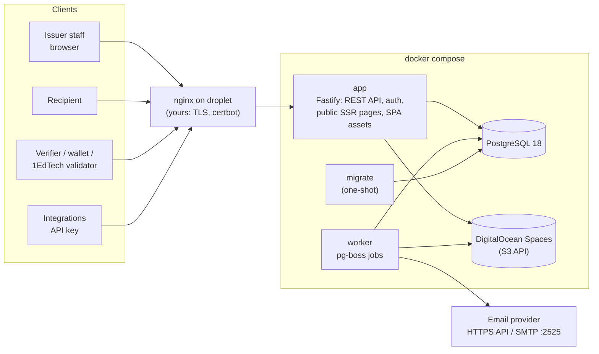
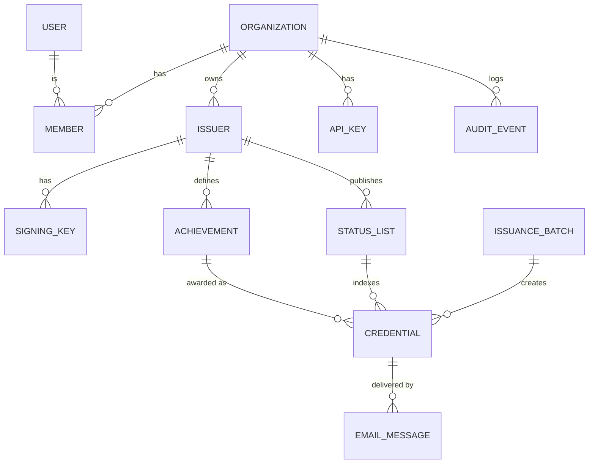

# credforge: Design Plan

**Status:** v0.6. M0–M4 are done. M1's sample credentials passed the 1EdTech validator on 2026-10-14, and a credential issued by the running app (M3) passed it on 2026-10-15 (§17). A credential revoked in the running app (M4) was reported as revoked by it the same day (§17). Findings and decisions from M1–M4 that changed the plan are folded into §4–§15, §17 and the decision log (§18).
**Date:** 2026-10-15
**Inputs:** `openbadges_platform_project_requirements.md` (first attempt), `branding/` (brand guide, copy kit, logo assets), and the 1EdTech Open Badges 3.0 spec (Final Release, document v1.4.5, June 29, 2026).

---

## 1. Product scope

**In one sentence:** credforge lets an organization create an achievement, award it to people using their email addresses, and give each recipient a signed Open Badges 3.0 credential that the recipient can view, share and download, and that anyone can verify.

### The core loop (the MVP must get this right)

1. An organization signs up and sets up its issuer profile (name, logo, website, contact).
2. It creates an **achievement** (name, description, criteria, image, skills/tags).
3. It **awards** that achievement to one recipient, or to many via CSV (name + email).
4. credforge builds and signs one OB 3.0 credential per recipient and emails each recipient a link.
5. The recipient opens the link and sees their badge page. They can download the baked PNG or the JSON, add it to LinkedIn, and share it.
6. Anyone with the link, JSON or image sees who issued it, to whom, what was earned, when, its current status, and the results of the proof checks.
7. The issuer can revoke a credential. The new status shows on the public page and in the signed status list.

### Users

| User | Needs an account? | What they do |
|---|---|---|
| **Issuer staff** (org members) | Yes | Create achievements, award, revoke, manage org |
| **Recipient** | **No.** The emailed link is enough | View, download, share, hide their credential |
| **Verifier** | No | Open the link or upload the badge, then read the verification result |
| **Platform admin** | Yes (instance-level flag) | Operates the instance: approves and suspends orgs, sets limits, watches health |

### Two ways to deploy, one codebase

- **Hosted instance** at `https://credforge.app`. You run it for many organizations.
- **Self-hosted.** Anyone runs their own instance with `docker compose up`.

So the code never hard-codes `credforge.app`. Every URL is built from `PUBLIC_BASE_URL`.

---

## 2. Key decisions at a glance

| Area | Decision | Why |
|---|---|---|
| Language/runtime | **TypeScript end to end, Node.js 24 LTS** | The most mature Data Integrity / VC libraries are JavaScript (Digital Bazaar's `@digitalbazaar/vc`, `eddsa-rdfc-2022-cryptosuite`, bitstring status list). One language covers the API, UI, worker and credential engine. |
| Server | **Fastify 5** with **Zod** schemas, generating **OpenAPI 3.1** | API-first. Every request and response is schema-validated, and the API docs are generated from the same schemas. |
| Issuer UI | **React 19 SPA** (Vite) with TanStack Router/Query, **Tailwind CSS v4** and **shadcn/ui** (Radix primitives) | The admin UI is just another client of the public REST API (dogfooding), so the API is guaranteed to be complete. Radix gives accessible components. |
| Public pages | **Server-rendered HTML** (React SSR) from the same Fastify app | Link previews on LinkedIn/Slack need server-side Open Graph tags. Verifiers without JavaScript still work, and pages are fast and printable. |
| Auth | **Better Auth** for identity: email+password, **Continue with Google** and **Microsoft**, email verification, TOTP MFA. Organizations, members, roles and invitations are credforge's own `/api/v1` resources (decision 11). Per-org enterprise SSO (OIDC/SAML) later. | A maintained, framework-agnostic library that covers sign-in, federated identity and second factors. Keeping orgs in credforge's own API puts every change and its audit event in one transaction and lets API keys (M5) use the same endpoints. |
| Database | **PostgreSQL 18** with **Drizzle ORM** and SQL migrations | Relational core. JSONB holds signed credentials. Migrations are typed and reviewable. |
| Background jobs | **pg-boss** (a queue stored in Postgres). **No Redis.** | One less stateful service to run and back up on a droplet. Jobs are enqueued in the same transaction as the data. |
| File storage | **DigitalOcean Spaces** (S3 API) for credforge.app; a local volume for self-hosters and offline dev | You already run Spaces. It is durable and off the droplet, and supports per-bucket access keys. |
| Email | **SendGrid v3 Web API** (HTTPS) is the primary transport. Generic SMTP (nodemailer) is the fallback for self-hosters. | **DigitalOcean blocks outbound SMTP on ports 25/465/587** on droplets ([DO docs](https://docs.digitalocean.com/support/why-is-smtp-blocked/)). An HTTPS API isn't affected. |
| Proof format (MVP) | **Data Integrity `DataIntegrityProof` with `eddsa-rdfc-2022` (Ed25519)** | This is the spec's Linked Data proof format. The 1EdTech conformance suite currently supports only this cryptosuite for that format. |
| Proof format (later) | VC-JWT with **RS256** (the spec's minimum algorithm) | Optional second format for consumers that prefer JWTs. |
| Issuer identity | **HTTPS URL**: `{PUBLIC_BASE_URL}/issuers/{id}`, which publishes Multikey verification methods | Spec §8.5: verifiers are only *required* to support HTTP URLs. This matches the spec's own examples. |
| Revocation | **W3C Bitstring Status List** (`BitstringStatusListEntry`) | This is the status type that the OB 3.0 verification algorithm (§9.1) checks. |
| Recipient identity | **Salted SHA-256 hashed email** (`IdentityObject`, `identityType: emailAddress`), plus the recipient's name | The email address never appears in plain text in the credential or on public pages. |
| Containers | **One image, three roles** (`app`, `worker`, `migrate`) plus `postgres`. The app binds to `127.0.0.1:3000`. | Your nginx proxies to a single upstream. |
| Signup (credforge.app) | **Approval required.** Orgs can sign up and set up, but can't award to anyone else until a platform admin approves them. | The strongest protection against impersonation and phishing on a public instance. |
| License | **Apache-2.0** | Permissive and includes a patent grant; best for adoption. |

---

## 3. Refinements to the original requirements

**Kept:** the vision, the three user types, standards alignment, the split between credential data and presentation, and the initial-release acceptance criteria.

**Changed or added:**

1. **Badges come first. A certificate is a view, not a separate product.** A certificate is a printable layout of the *same* signed credential. The MVP ships a print-optimized HTML certificate page (the browser's "Save as PDF" produces the PDF). A certificate designer and server-generated PDFs come in phase 2. The separate `BadgeTemplate`/`CertificateTemplate` entities are dropped.
2. **No Redis.** A Postgres-backed queue (pg-boss) covers background jobs. Rate limits live in memory on a single node, or in Postgres.
3. **Roles simplified from 5 to 4 org roles** (`owner`, `admin`, `issuer`, `viewer`), plus an instance-level platform admin. "Template designer" folds into `issuer`. Checks are permission-based, so roles can be added later without rewrites.
4. **Organization vs. issuer is explicit.** An *Organization* is the tenant and membership boundary. It owns one or more *Issuers*; each issuer is an OB `Profile` with its own keys and branding. The MVP UI creates one issuer per org, but the schema already allows several (for departments).
5. **Concrete standards choices replace "support VC concepts":** DI `eddsa-rdfc-2022`, Bitstring Status List, hashed email identity, PNG/SVG baking, and JSON-LD contexts pinned offline.
6. **Trust and anti-abuse controls are added.** A public hosted instance needs them. Without them, anyone could create an issuer named "Harvard" and send phishing emails through credforge. See §6.3.
7. **Deployment facts are written down:** `PUBLIC_BASE_URL` can never change, DigitalOcean blocks SMTP, and the master key needs its own backup.
8. **Explicitly post-MVP:** Kubernetes/Helm, SSO, sub-organizations, OB 2.0 import, webhooks, analytics, LMS integrations.
9. **Product claims follow the brand guardrails.** Don't claim "1EdTech certified", "analytics" or "integrations" until they exist. Certification is a goal, not a claim.
10. **Clean-up:** removed the stray citation tokens (`citeturn…`). The brand spells the name in lowercase: **credforge**.
11. **Federated sign-in is in the MVP** (Google and Microsoft), not a later phase. Per-org enterprise SSO (OIDC/SAML) stays in phase 2. See §6.4.
12. **Storage is concrete:** DigitalOcean Spaces, with permanent image URLs on the credforge.app domain so the storage provider can change without breaking issued credentials. See §5.4 and §13.5.

---

## 4. Architecture



### 4.1 Modules inside the app

It is one deployable with clearly separated modules:

| Module | Responsibility |
|---|---|
| `auth` | Better Auth: sessions, sign-in methods, email verification, TOTP; credforge's second-factor gate in front of it (§6.4) |
| `orgs` | Organizations, members, roles, invitations, the org-scoped access check (§7) |
| `issuers` | Issuer profiles, signing keys, domain verification, public profile documents |
| `achievements` | Achievement definitions, images, revisions |
| `issuance` | Single awards, CSV batches, drafts, idempotency |
| `credentials` | Lifecycle: issued, revoked, reissued, visibility |
| `delivery` | Email rendering and sending, claim tokens, delivery status |
| `public` | SSR pages and content negotiation (HTML vs. JSON) |
| `verify` | Verifying a URL, JSON or baked image |
| `status-lists` | Allocating indexes, flipping bits, signing and publishing lists |
| `audit` | Append-only event log |
| `api-keys` | Scoped keys for integrations |
| `files` | Upload validation, image processing, storage drivers |
| `platform` | Instance admin: orgs, limits, suspensions, queue and email health |

### 4.2 `packages/ob3`: the credential engine

This is a pure library with **no database and no HTTP**. It is where standards correctness lives, so it gets the most tests.

- Builds an `OpenBadgeCredential` from typed inputs.
- Validates output against the official OB 3.0 JSON Schema.
- Signs and verifies with `DataIntegrityProof` / `eddsa-rdfc-2022`.
- Hashes and checks recipient identifiers (`sha256$…` + salt).
- Bakes and extracts credentials in PNG (`iTXt` chunk, keyword `openbadgecredential`) and SVG (`<openbadges:credential>`).
- Encodes and decodes Bitstring Status Lists (GZIP + multibase).
- **Pinned JSON-LD document loader.** The contexts ship inside the package as byte-for-byte copies with recorded hashes: VCDM 2.0, OB 3.0.3, the OB 3.0 extensions context, W3C Controlled Identifiers v1.0, Multikey v1 and Data Integrity v2. The loader never fetches anything over the network, for security and reliability; issuer profiles are handed to it by the caller.
- Exposes a `Signer` interface, so the in-process key signer can later be swapped for a KMS or HSM.
- Verifies through two independent paths in its tests: Digital Bazaar's verifier, and a second verifier that shares no code with signing (a different JSON-LD processor and RDF canonicalizer, `node:crypto` for Ed25519).

Details, usage and the validator procedure are in `packages/ob3/README.md`.

---

## 5. Open Badges 3.0 credential design

### 5.1 What an issued credential looks like

```json
{
  "@context": [
    "https://www.w3.org/ns/credentials/v2",
    "https://purl.imsglobal.org/spec/ob/v3p0/context-3.0.3.json",
    "https://purl.imsglobal.org/spec/ob/v3p0/extensions.json"
  ],
  "id": "https://credforge.app/credentials/0b6f3c1e-5d0a-4b8e-9c55-1c2f7e3d9a10",
  "type": ["VerifiableCredential", "OpenBadgeCredential"],
  "name": "Intro to Network Defense",
  "issuer": {
    "id": "https://credforge.app/issuers/7f3e9a52-…",
    "type": ["Profile"],
    "name": "Example Cyber Academy",
    "url": "https://example.org",
    "image": { "id": "https://credforge.app/issuers/7f3e9a52-…/images/c41a9e….png", "type": "Image" }
  },
  "validFrom": "2026-11-02T15:04:05Z",
  "credentialSubject": {
    "type": ["AchievementSubject"],
    "identifier": [
      {
        "type": "IdentityObject",
        "identityType": "emailAddress",
        "hashed": true,
        "identityHash": "sha256$4d1c…",
        "salt": "Xk9q…"
      },
      {
        "type": "IdentityObject",
        "identityType": "name",
        "hashed": false,
        "identityHash": "Jordan Rivera"
      }
    ],
    "achievement": {
      "id": "https://credforge.app/achievements/2a91c4d0-…",
      "type": ["Achievement"],
      "achievementType": "Badge",
      "name": "Intro to Network Defense",
      "description": "Recognizes foundational skills in defending small networks.",
      "criteria": { "narrative": "Completed all six labs and scored 80% or higher on the final assessment." },
      "image": { "id": "https://credforge.app/achievements/2a91c4d0-…/images/9f2c7b….png", "type": "Image" },
      "tag": ["networking", "security"]
    }
  },
  "credentialStatus": {
    "id": "https://credforge.app/status/7f3e9a52-…/1#48213",
    "type": "BitstringStatusListEntry",
    "statusPurpose": "revocation",
    "statusListIndex": "48213",
    "statusListCredential": "https://credforge.app/status/7f3e9a52-…/1"
  },
  "credentialSchema": [{
    "id": "https://purl.imsglobal.org/spec/ob/v3p0/schema/json/ob_v3p0_achievementcredential_schema.json",
    "type": "1EdTechJsonSchemaValidator2019"
  }],
  "proof": {
    "type": "DataIntegrityProof",
    "cryptosuite": "eddsa-rdfc-2022",
    "created": "2026-11-02T15:04:05Z",
    "verificationMethod": "https://credforge.app/issuers/7f3e9a52-…#z6Mk…",
    "proofPurpose": "assertionMethod",
    "proofValue": "z…"
  }
}
```

Optional fields filled when present: `validUntil` (expiry), `evidence[]` (URL, name, narrative), `achievement.alignment[]` and skill tags, `credentialSubject.result[]`.

Details settled in M1 (the full signed example is `packages/ob3/test/fixtures/golden/credential.signed.json`):

- **The third `@context`, `…/ob/v3p0/extensions.json`, is required.** It is the only context that defines `1EdTechJsonSchemaValidator2019`, the `credentialSchema` type. Without it that type is an undefined term, and eddsa-rdfc-2022 canonicalization (JSON-LD safe mode) refuses to sign. The OB 3.0 spec's own examples include it, and the 1EdTech validator bundles it.
- **`statusListIndex` is a string**, as Bitstring Status List v1.0 requires. The OB 3.0 examples show a number; the 1EdTech validator reads both, and so does credforge's verifier.
- **`proof` is a single object**, as Digital Bazaar's library writes it (the schema allows an object or an array).
- **`identityHash`** is `sha256$` + hex of SHA-256 over the UTF-8 bytes of the normalized email followed by the salt. Normalization is trim, Unicode NFC and lowercase. The salt is 16 random bytes, base64url-encoded. This matches the spec's example vector (`a@example.com` + `Kosher`).

### 5.2 Rules

- **Signed credentials are immutable.** Any change, including fixing a typo in the name, means **reissue**: a new credential is created, and the old one is revoked with reason `superseded` and linked to the new one.
- **Editing an achievement never touches issued credentials.** Each credential embeds the achievement as it was at issue time. The achievement URL serves the current revision.
- **Self-check before saving.** Every newly signed credential is verified and schema-validated before it is stored. A signing bug therefore fails loudly instead of producing bad credentials.
- **Every public URL is permanent.** That covers issuers, achievements, credentials and status lists. IDs are random UUIDs, so recipients can't be discovered by guessing URLs.
- **Content negotiation on permanent URLs.** Browsers get HTML. `Accept: application/vc`, `application/ld+json` or `application/json` get the signed JSON. Explicit `.json` download links are provided too.

### 5.3 What the recipient gets

- A hosted credential page at the credential's `id` URL
- A baked **PNG** (and a baked **SVG** if the achievement image is SVG). Any OB 3.0 tool can extract the credential from the image.
- The signed **JSON** file
- **Add to LinkedIn** (LinkedIn's "add certification" URL with name, issuer, date, URL and credential ID)
- A **printable certificate** view
- *Phase 2–3:* push to digital wallets (see the roadmap)

### 5.4 Badge images

**What issuers can upload:**

- PNG, SVG, JPEG or WebP, up to 2 MB. JPEG and WebP are converted to PNG, because OB 3.0 defines baking only for PNG and SVG.
- Square artwork, at least 400×400 px, is recommended. Transparent backgrounds are fine. Anything larger than 2048 px is scaled down.
- Every upload is checked and cleaned on the server before it is stored (§12).
  - SVGs are sanitized.
  - Raster images are re-encoded losslessly, which strips metadata.

**Images generated at upload time:**

| Image | Used for |
|---|---|
| Original (cleaned) | The image in the credential, and baking |
| 512 px PNG | Credential pages and **emails** (most email clients don't display SVG) |
| 128 px PNG | Lists and tables in the issuer app |
| 1200×630 card | Link previews on LinkedIn, Slack and other sites (Open Graph): the badge on a branded background with the achievement name |

**Rules that keep issued credentials intact:**

- **Image URLs in credentials always point at credforge.app, never at the storage provider.** An example is `https://credforge.app/achievements/{id}/images/{hash}.png`. Images can later move off Spaces without breaking a single issued credential.
- **Image URLs are content-addressed**, meaning the URL contains the file's hash, so the bytes behind a URL never change. If an issuer replaces a badge image, the achievement gets a *new* URL. Credentials issued earlier keep pointing at the image they were issued with.
- **Images referenced by any issued credential are never deleted.** The code enforces this.
- **Baked badges are created on request, not stored.** Baking only inserts a text chunk into the PNG (no re-encoding), so it's fast. Storing a baked copy per credential would multiply storage for every 10,000-row batch. Responses are cached.

**As built in M3** (`apps/server/src/files/`):

- **File types by their bytes.** PNG, JPEG and WebP by their signatures; SVG when, after an optional BOM, XML declaration, comments and doctype, the first element is `<svg>`. The declared content type and the file name are ignored. GIF, PDF, HTML and everything else are refused (415). Over 2 MB is refused before decoding (413), and so is a canvas over 40 million pixels.
- **Raster images** are decoded with `sharp`, EXIF-rotated, scaled to fit 2048 px and re-encoded as PNG, which drops all metadata. JPEG and WebP become PNG.
- **SVG sanitizing** parses the file as XML (`@xmldom/xmldom`) and rebuilds it from an allowlist of static drawing elements and presentation attributes. Removed: scripts, event handlers, `foreignObject`, animation (`animate`/`set` can rewrite links), links (`<a>` keeps its drawing as a `<g>`), metadata, editor namespaces, processing instructions, `xml:base`. References must stay inside the file: `href` only `#id`, `url()` only `#id`, CSS without `@import`, escapes or external URLs, and embedded rasters only as PNG/JPEG/GIF/WebP data URIs. A DTD with entity definitions is refused outright; a plain doctype is dropped. The sanitized SVG must render (librsvg via sharp) and have a viewBox or a size.
- **Variants:** 512 and 128 px PNGs (the image centered on transparency; SVGs are rasterized at the density that keeps them sharp at that size), and for badges the 1200×630 Open Graph card. **The card has no text** (decision 15): the badge sits on a light canvas between the brand's angled ink, teal and violet bars.
- **Content addresses:** the URL holds the full hex SHA-256 of the cleaned original. The same image uploaded again for the same achievement reuses its record.
- **Served** by the app with `Cache-Control: public, max-age=31536000, immutable`, an `ETag`, `X-Content-Type-Options: nosniff`, `Content-Security-Policy: default-src 'none'; style-src 'unsafe-inline'; sandbox`, `Cross-Origin-Resource-Policy: cross-origin` (other sites may show badges) and CORS `*`.
- **Retention:** the files an issued credential refers to (its badge image and the issuer's logo at the time) are marked `retain` in the award's transaction and are never deleted. Deleting a draft achievement or replacing a logo deletes only files nothing retains.
- **Baking on request:** `badge.png` bakes into the cleaned PNG original, or into the 512 px PNG when the artwork is SVG; `badge.svg` exists only for SVG artwork. Both are cached for 5 minutes (not at all once the recipient has hidden the page).
- **Issuer logos** use the same pipeline (original, 512 and 128 px; no Open Graph card) and arrived with M3 (decision 13).

---

## 6. Identity, keys and trust

### 6.1 Issuer identifiers and key discovery

- Issuer `id` = `{PUBLIC_BASE_URL}/issuers/{uuid}`. Requesting it as JSON returns the OB `Profile`, which also works as a controller document. It lists each published key as a `Multikey` verification method (`publicKeyMultibase` starting with `z6Mk…`) and references it from `assertionMethod`. Requesting it as HTML returns the public issuer page.
- Proofs use `verificationMethod: "{issuerId}#{publicKeyMultibase}"`, the same pattern as the spec examples.
- `did:web` (`did:web:credforge.app:issuers:{uuid}`) is a possible later option but not MVP.
- **Interop risk settled in M1.** The profile document's shape is pinned down and tested:

  ```json
  {
    "@context": [
      "https://www.w3.org/ns/credentials/v2",
      "https://purl.imsglobal.org/spec/ob/v3p0/context-3.0.3.json",
      "https://www.w3.org/ns/cid/v1"
    ],
    "id": "https://credforge.app/issuers/7f3e9a52-…",
    "type": ["Profile"],
    "name": "Example Cyber Academy",
    "url": "https://example.org",
    "verificationMethod": [{
      "id": "https://credforge.app/issuers/7f3e9a52-…#z6Mk…",
      "type": "Multikey",
      "controller": "https://credforge.app/issuers/7f3e9a52-…",
      "publicKeyMultibase": "z6Mk…"
    }],
    "assertionMethod": ["https://credforge.app/issuers/7f3e9a52-…#z6Mk…"]
  }
  ```

  - **The W3C Controlled Identifiers v1.0 context (`https://www.w3.org/ns/cid/v1`) is needed.** Neither the VCDM 2.0 nor the OB 3.0 context defines `verificationMethod`, `assertionMethod`, `controller`, `Multikey` or `publicKeyMultibase`. Digital Bazaar's verifier processes the controller document as JSON-LD in safe mode, where undefined terms are errors. The three contexts combine without protected-term conflicts.
  - **Digital Bazaar's verifier** (`@digitalbazaar/vc` + `data-integrity` + `eddsa-rdfc-2022-cryptosuite`) dereferences the key id, then the controller document, and checks that `assertionMethod` lists the key and that the key's controller is the credential issuer. credforge's verifier serves both from the issuer profile; the key comes back with the Multikey context, which the key library requires.
  - **The 1EdTech validator** (`EmbeddedProofProbe` in its public source) reads the key straight from a `{controller}#z6Mk…` fragment and only checks that the controller equals `issuer.id`. It doesn't fetch the profile for the proof. Its fallback for other key URLs expects type `"MultiKey"` with a capital K, which never matches a conformant `Multikey`, so the fragment form is the one that works there. One consequence: it can't see a key that was revoked in the profile.
  - Shape rules both rely on: `verificationMethod` is an array, `assertionMethod` holds id strings, and each method's `controller` is exactly the issuer id.
  - The HTTPS-URL form verifies on both paths, so the `did:web` fallback isn't needed. The engine is id-agnostic and is tested with a `did:web` issuer too.

### 6.2 Key custody

- Each issuer gets an **Ed25519** key pair, generated server-side when the issuer is created. It is kept in Multikey form: `publicKeyMultibase` (`z6Mk…`) and `secretKeyMultibase` (`z3u2…`, the 32-byte seed), the format of the W3C test vectors.
- Private keys are **encrypted at rest** with AES-256-GCM under a **master key** from `CREDFORGE_MASTER_KEY` (or a Docker secret file). Leaking the database alone does not let anyone forge credentials.
- The master key is versioned (`kek_version`), so it can be rotated with a CLI command that re-encrypts all issuer keys.
- Private keys never leave the server process. They are never logged, never returned by the API, and never exported in the MVP.
- **Key states:**
  - `active`: signs new credentials.
  - `retired`: still published, so older credentials keep verifying.
  - `revoked`: removed from `assertionMethod`, so credentials it signed fail verification. The UI then offers a bulk reissue.
- Org owners can rotate keys from the UI. A CLI command does the same.

**Built in M2:**

- An issuer's first key is generated when the issuer is created (`generateEd25519KeyPair` from `packages/ob3`). The creation fails unless the stored key decrypts back into a working signer.
- Stored as `{iv}.{ciphertext}.{tag}` (base64url): AES-256-GCM, a random 96-bit IV per value, and additional authenticated data `credforge:signing-key:{keyId}`. An encrypted key copied into another row doesn't decrypt.
- `kek_version` is `1` for now. The rotation CLI and its environment variables arrive with key rotation (M5).
- `CREDFORGE_MASTER_KEY` (or `CREDFORGE_MASTER_KEY_FILE`) takes 32 bytes as base64, base64url or hex. `migrate`, `app` and `worker` record a value encrypted under it on first start (`instance_settings.master_key_check`), and refuse to start if a later key can't decrypt it. A wrong or lost key is caught at startup, not at the next signature.
- The API returns only the public key, its status and its creation date.

### 6.3 Trust and anti-impersonation (hosted instance)

- **Issuer domain verification.** The issuer proves it controls its website domain with a DNS TXT record (`_credforge.example.org TXT "credforge-verify=…"`) or a file at `/.well-known/credforge-verify.txt`. Public pages then show "Website verified: example.org". Unverified issuers show their website as *self-reported*. The wording stays precise, per the brand guardrails.
- **Approval gate** (`SIGNUP_MODE=approval`, the credforge.app setting). A new org starts as `pending`. It can complete its issuer profile, create achievements and **test-award to its own members' verified email addresses**, so it still gets to its first badge quickly. Awarding to anyone else waits until a platform admin approves the org. The admin gets a queue of pending orgs showing name, website, domain-verification status and requester; the org is emailed when it is approved or declined. Self-hosters usually choose `open` or `invite`.
  - **Built in M3:** the test-award rule. While the org is `pending`, an award (and its email) must go to the confirmed address of one of the org's members, otherwise `403 recipient_not_allowed`. Approved orgs award to anyone.
  - **Built in M2:** the statuses and transitions (approve: pending/declined → active; decline: pending → declined; suspend: pending/active → suspended; reinstate: suspended → active, or pending if it was never approved), the queue on the **Platform** screen, emails to the owners on approve, decline and suspend, and an email to every platform admin when an org is created. Suspended and declined orgs are read-only (`org_inactive`). The test-award rule itself is enforced with awarding in M3.
  - One person can have at most 3 orgs waiting for approval. An org a platform admin creates is active at once.
  - `open`: new orgs are active at once. `invite`: an account can only be created for an address with a pending invitation, and only platform admins create orgs. A refused sign-up gets the same answer as a normal one (Better Auth's protection against account enumeration), so the sign-up screen says up front that the site is invite-only.
  - The first platform admin comes from the CLI: `node dist/cli.js create-platform-admin --email …` promotes an existing account, or creates one (email marked verified) and prints a one-time link to set its password.
- **Daily send cap.** A per-org daily cap (`DEFAULT_ORG_DAILY_SEND_LIMIT`) is a second guard even after approval, in case an account is compromised. Platform admins can raise it per org.
  - **Built in M3:** award emails (first sends and resends) queued by the org in the last 24 hours (rolling, not per calendar day) are counted under a lock on the org row, so parallel awards can't overshoot. Over the limit the award fails with `429 send_limit_reached`; an award without email isn't counted. The default is 1,000; `organization.daily_send_limit` overrides it per org (null: the default, 0: no limit), set on the Platform screen (decision 21). Suspending an org also stops award emails still in the queue: the worker marks them failed.
  - **Built in M4:** a CSV batch is checked against the cap as a whole when it is confirmed: if its emails would pass what the org can still send in the next 24 hours, confirming fails with `429 send_limit_reached` and says how many it can send (award fewer, award without email, or ask for a higher limit). Nothing is half sent. Each row's award still counts and checks the cap under the org lock, so a single award made meanwhile can't overshoot it; a row refused that way stops the batch. The approval gate applies per row: while the org is pending, rows for anyone but members' confirmed addresses are marked invalid in the validation report.
- **Suspension.** A platform admin can suspend an org, which stops all issuing and emailing. Existing credentials stay verifiable unless they are revoked for abuse.
- **Report abuse.** Every public credential page has a "Report a problem" link.
- **No spoofing in email.** Award emails are sent from the credforge domain, with the display name "Example Academy via credforge" and `Reply-To` set to the issuer's contact address. They never pretend to come from the issuer's domain (DMARC).

### 6.4 Sign-in and federated identity

This covers issuer staff and platform admins. Recipients still need no account. When the "My badges" page arrives (phase 2), it will offer the same sign-in buttons.

| Sign-in method | When | Notes |
|---|---|---|
| Email + password | M2 | Email verification required |
| **Continue with Google** | M2 | OpenID Connect, basic scopes only (`openid email profile`) |
| **Continue with Microsoft** (work, school and personal accounts) | M2 | Most schools and companies run on Microsoft 365. Little extra work once Google works. |
| GitHub | Optional, configuration only | Useful for developer and CTF communities |
| Enterprise SSO per org (OIDC or SAML, e.g. "acme.edu staff must use Acme's Okta") | Phase 2 | Better Auth SSO plugin, tied to the org's verified domain (§6.3) |
| Passkeys | Phase 2 | As a sign-in method and as a second factor |

A provider is switched on only when its client ID and secret are configured, so self-hosters enable just the ones they want.

**How sign-in methods attach to people:**

- One credforge user can have several sign-in methods: password, Google, Microsoft. Their memberships, roles and audit history are the same whichever one they use.
- **Signing up with Google** creates a user whose email counts as verified, because Google vouches for it (`email_verified`).
- **Microsoft caveat:** for multi-tenant apps, Microsoft's `email` claim is *not* verified. Anyone who runs their own Entra tenant can put any address there; this is the "nOAuth" account-takeover issue. credforge trusts a Microsoft email only when the `xms_edov` claim (email domain owner verified) is true. Otherwise it sends its own verification email before the account can do anything.
- **No silent account merging** (`disableImplicitLinking`). Say someone already has a password account for `jordan@acme.edu` and clicks "Continue with Google". They are told to sign in the usual way and connect Google under **Settings → Sign-in methods**. This closes the main takeover path for federated login. A method can be disconnected as long as at least one remains.
- **Provider tokens are not kept.** credforge only needs to know who signed in. A database hook strips the Google/Microsoft access and refresh tokens before the account record is saved, so nothing can act on the user's Google account later.
- **Invitations** to `jordan@acme.edu` can be accepted by signing in with any method whose verified email matches.

**Two-step verification and federated sign-in:**

- Better Auth enforces its two-factor check only on password sign-in. Google and Microsoft sign-ins skip it by default.
- credforge can't tell whether someone's Google account uses 2-step verification. So on credforge.app, **owners and admins must pass a credforge second factor (TOTP) after *any* sign-in method**. This is a small custom hook in the `auth` module, with tests. Issuers and viewers are encouraged to enable it, but it isn't required.
- Later, enterprise SSO connections that report MFA in the token (`amr` claim) can be trusted instead.

**How M2 built it:**

- **Per-session second factor.** Each session records when it passed a TOTP or backup code (`session.mfa_verified_at`). It is set when a code is verified after a password, on an existing session (the step-up after Google or Microsoft), and when two-step verification is first turned on.
- **Who must pass it** (`REQUIRE_MFA_FOR_ADMINS=true`): owners and admins of any org, and **platform admins** too (the most privileged accounts). Without it turned on, the session's state is `setup`; with it on but not yet passed in this session, `challenge`. **Anyone who turned it on voluntarily is challenged after Google or Microsoft sign-in too**, since that is what they would expect.
- **The gate.** In `setup` or `challenge`, `/api/v1` answers `403 mfa_setup_required` / `mfa_required` (only `GET /api/v1/me` works, without memberships or invitations), and only the Better Auth endpoints that lead through the second factor are reachable. Linking or unlinking sign-in methods, changing the password, reading the TOTP secret and turning two-step verification off all wait until the session has passed it. Covered by tests that run the real OAuth callback.
- **Google- or Microsoft-only accounts** can turn on two-step verification without a password (Better Auth's `allowPasswordless`). Accounts with a password must enter it.
- **"Trust this device"** is not offered: every session passes the second factor.
- **Microsoft:** basic OpenID scopes only (`openid profile email`), no Graph access, no profile photo download, no refresh token. Both providers use `requireEmailVerification`, so an unverified provider email gets credforge's confirmation email and no session until it is confirmed.
- **Sign-in methods** (Settings): connect Google or Microsoft (the provider account must use the same email), disconnect one as long as another remains, and "Set a password" for a provider-only account (it sends the password-reset link, which adds a password).
- **Audit:** account creation, email confirmation, sign-ins (with method), sign-in methods added and removed, password changes and resets, two-step verification on and off, and new backup codes are all recorded.
- **Development redirect URIs** use the Vite origin: `http://localhost:5173/api/auth/callback/{google|microsoft}` (not port 3000).

**Setup for credforge.app** (a checklist goes in the deployment guide):

- **Google Cloud:**
  - Configure the OAuth consent screen: External; name "credforge"; logo; homepage `https://credforge.app`; **privacy policy and terms URLs**; authorized domain `credforge.app`.
  - Create a Web OAuth client with redirect URI `https://credforge.app/api/auth/callback/google`.
  - Basic scopes need no Google security review. Showing the credforge name and logo on the consent screen requires brand verification, which needs the privacy policy and proof that you own `credforge.app`.
- **Microsoft Entra:**
  - Register an app for any organizational directory and personal accounts.
  - Redirect URI: `https://credforge.app/api/auth/callback/microsoft`.
  - Add the optional claim `xms_edov`.
  - Publisher verification (needs a Microsoft Partner Network ID) removes the "unverified" label. It's optional.
- **Development:** separate dev OAuth clients with `http://localhost:5173/api/auth/callback/…` redirect URIs (the Vite dev server forwards `/api` to the app).

---

## 7. Domain model



| Entity | Key fields | Notes |
|---|---|---|
| `user`, `session`, `account`, `verification`, `two_factor` | (managed by Better Auth) + `user.is_platform_admin`, `session.mfa_verified_at` | UUID ids. Provider tokens in `account` are always null (§6.4) |
| `organization` | name, `status` (pending / active / suspended / declined), `status_reason`, `status_changed_at`, `created_by`, `approved_by`, `approved_at`; `daily_send_limit` arrives with sending (M3) | Tenant boundary. No `slug`: org URLs use the id |
| `member` / `invitation` | org, user/email, `role`; invitations also hold the SHA-256 of the link token, `status` (pending / accepted / revoked), `expires_at` (7 days), `invited_by`, `accepted_by` | owner · admin · issuer · viewer. One open invitation per address per org; inviting again sends a fresh link |
| `issuer` | **uuid (public)**, org, name, description, url, email; logo, accent color, `domain`, `domain_verified_at` arrive with images (M3) and domain verification (M5) | The OB `Profile` |
| `signing_key` | org, issuer, algorithm (Ed25519), `public_key_multibase`, **encrypted private key**, `kek_version`, `status` (active / retired / revoked), timestamps | At most one active key per issuer |
| `achievement` | **uuid (public)**, issuer, name, description, criteria (narrative / url), `achievement_type`, image, tags, alignments (jsonb), default validity period, `revision`, `status` (draft / active / archived) | |
| `credential` | **uuid (public)**, org, issuer, achievement + revision, batch, `recipient_email` (normalized), `recipient_name`, `email_salt`, `status` (draft / issued / revoked), `valid_from`, `valid_until`, **`document` (signed VC, jsonb)**, `signing_key_id`, status list + index, evidence, custom fields, `visibility`, `claim_token_hash`, `accepted_at`, revocation reason/time, `replaced_by_id`, issued_by (user or API key) | "Expired" is computed from `valid_until`, never stored |
| `issuance_batch` | org, achievement, source (csv / api), file, column mapping, `status`, counts, per-row results | |
| `status_list` | issuer, purpose, size (131,072 entries), bitstring, allocation state, `version`, published signed document | Indexes are assigned **randomly**, which gives recipients herd privacy |
| `email_message` | org, credential, kind, recipient, provider message ID, `status` (queued / sent / delivered / bounced / failed), attempts, error | Drives the delivery status the issuer sees |
| `email_template` | org/issuer, kind, subject, body (limited Markdown) | Defaults ship with the app |
| `api_key` | org, name, `prefix`, **hash**, scopes, last used, expiry, revoked | The key is shown once |
| `audit_event` | org (null for account-level events), actor (user / api_key / system / recipient) with its email at the time, action, target, IP, user agent, data, time | **Append-only:** the app's database role is granted only SELECT and INSERT, and triggers reject UPDATE, DELETE and TRUNCATE for every role. No foreign keys, so nothing cascades into it |
| `file` | org, kind (issuer logo / badge image / CSV import / export), storage driver + bucket + key, MIME type, size, **sha256**, dimensions, derived variants, `visibility` (public / private), `retain` (set once an issued credential references it) | Public images are content-addressed (§5.4) |

**Tenant isolation:** every tenant-owned row has `org_id`. The data-access layer requires an org scope on every query. An integration test tries cross-tenant access against **every** endpoint. Postgres row-level security is a defense-in-depth hardening item.

As built in M2: every org-scoped endpoint lives under `/api/v1/orgs/{orgId}/…`. Before any handler runs, the caller's membership of that org is loaded; a non-member gets the same 404 as for an org that doesn't exist, and every query filters on the org id as well as the resource id. The cross-tenant suite (`apps/server/test/integration/cross-tenant.test.ts`) takes the route list from the app itself and fails if an org-scoped route has no case. It tries each route with another org's id, and with the caller's own org id plus another org's resource ids, then checks the other org's rows are unchanged.

**As built in M3** (migration `0003_achievements_credentials`):

- `achievement` holds the current revision; every saved change to a signed field (name, description, criteria, type, image, tags, alignments, default validity) bumps `revision` and adds an `achievement_revision` row with the snapshot. Credentials record `achievement_revision` and embed that version. Status: `draft` (not awardable, page not public, can be deleted) → `active` (needs an image) ↔ `archived` (not awardable; its page stays up).
- `file` adds `subject_id` (the achievement or issuer an image belongs to), unique per kind, subject and SHA-256.
- `credential` as listed, plus `image_file_id` (the badge image it was issued with, for baking), `claim_token_expires_at` and `issued_by_type`/`issued_by_id`. Its `id` is generated before signing, since it is the credential's URL.
- `status_list` keeps two bitstrings as `bytea`: `allocated` (indexes handed out) and `statuses` (the published bits), plus the signed `document` for `version`. Lists are numbered per issuer (`/status/{issuerId}/1`, `/2`, …); the first is created and signed at the issuer's first award.
- `email_message` statuses are `queued`, `sent`, `delivered`, `bounced`, `dropped`, `spam_reported` and `failed`, with the provider's events kept for the timeline (`events`, at most 50). "Opened" is the credential's `accepted_at`, not an email status.
- **Not built yet:** `email_template` (issuer-editable email text; the award email uses credforge's own wording for now), `api_key` (M5), the issuer's accent color.

**As built in M4** (migration `0004_batches_revocation`):

- `issuance_batch`: org, achievement, source (`csv` / `api`), the uploaded file (a private `csv_import` `file`), `file_name`, `has_header`, the column mapping (`columns`: each column's name and what it holds), `options` (`sendEmail`, `awardExisting`), `status` (draft → queued → running → completed, or failed with `error`), `total_rows`, who created and confirmed it, timestamps. Counts are computed from the rows, never stored.
- `issuance_batch_row` (decision 22): batch + `row_number` (the line in the file, so "row 7" is row 7 in a spreadsheet), the raw `cells` (so the mapping can change), the mapped `values`, the check result (`validation`: ready / invalid / duplicate / existing) with its `issues`, the issuing `status` (draft → pending → issued / failed, or skipped), the `credential_id` and the error.
- `credential` gains `batch_row_number` (with `batch_id`, now a foreign key; a unique index allows one credential per batch row), `revocation_public_reason`, `revocation_kind` (`revoked` / `superseded`), `replaces_id` (with the existing `replaced_by_id`, links a reissue both ways) and `custom_fields` (extra CSV columns; not signed, not public, decision 24).
- `status_list.needs_publish`: set when a bit in `statuses` changed after `document` was signed; the worker re-signs the list, bumps `version` and clears it (decision 26).
- New permission `credential:export` (owners and admins).

**Database roles:** `migrate` runs as the database owner (`MIGRATION_DATABASE_URL`) and creates or updates the app's role from `DATABASE_URL`: DML on the app's tables (SELECT and INSERT only on `audit_event`) and on the job queue's tables, no DDL, owns nothing. The app and worker run their job queue clients with `migrate: false`. If both URLs use the same user, migrate logs a warning and the triggers still keep the audit log append-only.

---

## 8. Key flows

### 8.1 Onboarding: "time to first badge" under 5 minutes

Sign up → verify email → name your organization → turn on two-step verification (required for owners when `REQUIRE_MFA_FOR_ADMINS=true`) → issuer profile (name, website, logo, contact email) → *(optional)* verify your domain → create your first achievement → award it to yourself as a test → see exactly what your recipients will see.

In M2 the org overview shows this as a checklist; the logo, domain and achievement steps are marked as coming later.

On credforge.app the org is *pending* during all of this. A banner explains that awarding to other people opens once the org is approved; verifying the domain makes approval faster. Approval emails the org owner, and a platform admin can approve or decline from the Platform screen.

### 8.2 Award one

Choose an achievement → enter the recipient's name and email (optional: evidence, issue date, expiry) → **preview** the badge page and the email → **Award**.
On the server, one transaction validates the input, allocates a status-list index, builds the credential, signs it, self-verifies it, inserts it, writes the audit event, and enqueues the email and image-baking jobs. Signing a single credential takes milliseconds, so it happens synchronously.

**As built in M3** (`apps/server/src/credentials/service.ts`, `POST /api/v1/orgs/{orgId}/credentials`), in one transaction:

1. Lock the org row; refuse suspended and declined orgs.
2. Check the achievement is `active`, a pending org's recipient is a member with that confirmed address (§6.3), and the daily send cap (§6.3).
3. Lock the issuer row (this serializes status-list allocation per issuer); load its active key and decrypt it.
4. Allocate a random free index in the issuer's current revocation list, creating and signing list 1 (or the next one, when full) if needed.
5. Build the credential (the issuer, logo and achievement as they are now; the recipient's salted email hash and name; `validFrom` from the award date, `validUntil` from the form or the achievement's default validity; evidence; the status entry), sign it, and self-check it against the schema and the issuer profile as published (`issueCredential` in `packages/ob3`).
6. Insert the credential with the SHA-256 of a new claim token, mark its images retained, write `credential.issued` to the audit log, insert the `email_message` row and enqueue the email job **in the same transaction** (pg-boss writes through the transaction's connection; decision 19).

There are no image-baking jobs: baking happens on request (§5.4). A calendar date as the award date means "earned that day" (midnight UTC, or now for today in a time zone ahead of UTC); a future date is refused. The issuer app previews the recipient's page and the email (`POST …/credentials/preview`, which signs nothing).

### 8.3 Award many (CSV)

Upload a CSV (MVP limit: 10,000 rows / 5 MB, with a downloadable template) → map columns (auto-detected) → **validation report** (invalid emails, duplicates within the file, people who already hold this achievement) → confirm → the batch job runs in chunks and is idempotent per row → live progress → results CSV (each row gets a credential URL or an error).

**As built in M4** (`apps/server/src/batches/`, `/api/v1/orgs/{orgId}/batches`):

1. **Upload.** The file is the raw request body (`Content-Type: text/csv`, also `application/csv` and Excel's `application/vnd.ms-excel`; `?achievementId=…&fileName=…`), like image uploads: no multipart parsing. Over 5 MB is refused before parsing (413). The API also takes the rows as JSON instead (`{ achievementId, rows: [{ name, email, issuedOn?, expiresOn?, evidenceUrl?, custom? }] }`), checked the same way.
2. **Reading.** UTF-8 with or without a byte order mark, or Windows-1252 when the bytes aren't UTF-8. The separator (comma, semicolon or tab) is taken from the first line. `csv-parse` streams the records and stops at the 10,001st data row, at more than 50 columns, or at a cell over 2,000 characters. Blank lines are skipped and cells trimmed. The original file is stored privately (`orgs/{orgId}/imports/{batchId}.csv`) and deleted after 30 days by the worker's sweep; the batch and its rows stay.
3. **Columns.** The first line is a header unless one of its cells is an email address. Column names are matched against synonyms (`E-mail`, `Full name`, `Completion date`, `Expiry`, `Portfolio`, …); without a header the values decide (emails, dates, links, then the first text column is the name). Targets: full name, or first and last name; email; award date; expiry date; evidence link; **custom field** (kept with the credential for the org's records); or not used. The issuer changes any of them, or whether line 1 is a header, while the batch is a draft; every row is checked again at once.
4. **Validation report.** Each row: a name (at most 200 characters), a valid email (normalized), dates as `YYYY-MM-DD` (or ISO date-times; `02/11/2026` is refused as ambiguous, decision 32), no award date in the future, expiry after the award date, a full http(s) evidence link. Across rows: the same email on an earlier row (`duplicate`), people who already hold the achievement (`existing`: skipped unless "Award again" is ticked), and, while the org is pending, addresses that aren't members' (`invalid`). The report lists each group with its rows and reasons.
5. **Confirm.** One transaction locks the org, checks the batch once more, refuses it if the emails would pass the daily cap (§6.3) or nothing can be awarded, marks the rows to award `pending` and the rest `skipped` (with the reason), writes `batch.confirmed` to the audit log and enqueues the job.
6. **Issuing.** The worker issues pending rows one transaction each: lock the row (`FOR UPDATE SKIP LOCKED`), award it through the same `awardInTransaction` as single awards (inside a savepoint, so a refused award rolls back alone and the row records why), mark it `issued` with the credential id. A row is therefore issued at most once even if a job runs twice, and the database allows only one credential per batch row as a second guard. Each award enqueues its own email job in its transaction, so a failed email never resends others (the worker sends about 8 a second). A job works for up to 60 seconds and then queues the next one, so long batches don't hold a job and other batches get a turn. When an error means no later row can succeed (`org_inactive`, `achievement_not_active`, `issuer_not_ready`, `send_limit_reached`), the remaining rows fail with it and the batch stops (`failed`). Signing takes about 60 ms a credential: 50 rows took 3 seconds in development.
7. **Progress and results.** The issuer app polls the batch every 1.5 seconds while it runs. `results.csv` lists every data row: row number, name, email, result (awarded / skipped / failed / waiting / not confirmed), the credential URL or the problem, and the custom fields; cells are escaped for spreadsheets (§12).
8. **Lost jobs.** The database, not the queue, says what is left: the worker's minute sweep re-queues queued or running batches that haven't moved for two minutes.

### 8.4 Delivery and claim (no recipient account)

- The email ("Example Academy awarded you Intro to Network Defense") links to `/credentials/{id}?t={claimToken}`.
- A valid token marks the credential *accepted* and unlocks owner actions: download PNG/JSON, add to LinkedIn, and **hide or show** the public page.
- Without the token, visitors see the public view.
- Claim tokens are 256-bit random values, stored hashed, valid for 90 days, and can be re-sent.
- Issuers see each credential's delivery status: queued → sent → delivered/bounced → opened.
- **SendGrid specifics:**
  - Mail is sent through the v3 Mail Send API.
  - **Click tracking and open tracking are turned off** on award emails, so claim tokens never pass through SendGrid's redirect domain. "Opened" is recorded when the recipient first visits the claim link, a first-party signal that is more accurate than a tracking pixel.
  - Delivered, bounce, dropped and spam-report statuses arrive through SendGrid's **signed Event Webhook** at `/api/webhooks/sendgrid`. The app checks the ECDSA signature before trusting an event.
  - Hard bounces are flagged on the credential so the issuer can fix the address and reissue.

**As built in M3:**

- **The claim link is traded for a cookie.** Opening `/credentials/{id}?t={token}` with a valid token sets an HttpOnly, SameSite=Lax cookie scoped to `/credentials/{id}` (Secure on HTTPS, expiring with the token) and redirects to the clean URL (decision 17). The token doesn't stay in the address bar, so a recipient who copies the address to share their badge doesn't share their token. An unknown or expired token leads to the page with a "this link no longer works" notice.
- **Accepted / opened** is recorded the first time a valid token is used (`credential.accepted_at`; audit `credential.claimed`, actor: the recipient). Mail scanners that open links can set it early: it is a first-party signal, not proof of reading.
- **Recipient actions** with the cookie: Add to LinkedIn, and hide or show the page (a plain form post, checked for this site's origin; audit `credential.hidden` / `credential.shown`). Downloads are open to anyone who can see the page (decision 20). A hidden credential answers 404, in HTML, JSON and every download, to everyone but its recipient.
- **Resend** (`POST …/credentials/{id}/resend`) makes a new token and a new 90 days; only the newest token works. It counts against the daily send cap.
- **The email** comes from `EMAIL_FROM`'s address as "{issuer} via credforge", Reply-To the issuer's contact address, with the 512 px badge image, the link and the date it stops working.
- **Delivery tracking:** the email job carries the `email_message` id. The worker skips a message that was already sent (a job picked up again after a crash) and doesn't send for a suspended org; after a successful send nothing may throw, so a retry can't send twice. SendGrid's 400 and 413 answers are final (no retry); other failures retry with backoff for about an hour, then the message is `failed`. The worker keeps polling as before: four pollers every 0.5 s, one job per fetch.
- **SendGrid:** v3 Mail Send with click, open, subscription and Google Analytics tracking off on every message (verification and password-reset links carry tokens too), the `email_message` id as a custom argument and the kind as a category. The Event Webhook checks the ECDSA P-256 signature over the timestamp header plus the raw body before parsing anything. Events match by the custom argument (or SendGrid's message id), each event applies once (`sg_event_id`), and statuses only move forward (a late "delivered" never hides a bounce). Bounces, drops and spam reports go to the audit log. Opens and clicks are ignored.
- **The issuer sees** each award's timeline: awarded → emailed → delivered or bounced → opened, with the provider's reason for a bounce.

### 8.5 Verify

- **Three entry points:** the credential URL, the `/verify` page (paste a URL or JSON, or upload a baked PNG/SVG), and `POST /api/v1/verify`.
- **Each check is shown separately:**
  1. Format and schema are valid.
  2. The signature checks out with a key published by this issuer.
  3. The credential is not revoked (status list checked at {time}).
  4. The current date is within the validity period.
  5. *Optional:* "Is this credential for `someone@example.com`?" (salted-hash comparison; the email is not stored).
- The wording is factual ("Signature checked") and never overclaims ("Guaranteed authentic").

**As built in M4** (`apps/server/src/verify/`, `/verify`, `POST /api/v1/verify`):

- **Input:** a URL (a credential's address, a credential JSON URL, or a baked image's URL), the JSON (an object or text), a baked PNG or SVG (base64, a data: URL, or the raw body with `Content-Type: image/png` / `image/svg+xml` on the API), and optionally an email address. A JWT-signed credential is reported as not supported: credforge checks Data Integrity proofs (`eddsa-rdfc-2022`) only.
- **This instance's credentials and documents** (issuer profiles, status lists, credential URLs under `PUBLIC_BASE_URL`) are read from the database exactly as they are served. A hidden credential's URL answers as if there were no credential. **Other issuers' documents** are fetched by a safe fetcher (decision 29): HTTPS on port 443 only, every address the host resolves to must be public (no loopback, private, link-local, CGNAT, reserved or IPv4-mapped equivalents), the connection is pinned to the checked address, redirects (at most 3) are checked the same way, 5 seconds and 3 MB at most. An HTML page that names its JSON (`<link rel="alternate">`, as credforge's pages do) is followed once.
- **Checks** come from `verifyCredential` in `packages/ob3`: format and schema; the signature with a key the issuer publishes ("Signature checked with a key published by the issuer"); status ("Not revoked (status list checked at …)"); the validity dates; and, with an email, "Issued to this email address (matched against the salted hash in the credential)" or "Not issued to this email address". A wrong address doesn't make the credential fail. Nothing about a check is stored or logged.
- One of this instance's credentials revoked in the seconds before its list is re-signed is reported as revoked ("Its signed status list is being updated"), as its page does.
- **The page** is a plain form (works without JavaScript; multipart only for the file) with the result above it. `GET /verify?url=…` checks straight away, so a badge's page or the issuer app can link to its own check.
- **Rate limit:** `VERIFY_RATE_LIMIT` checks per client IP per minute (default 20, shared by the page and the API), in memory on the app process. Over it: `429 rate_limited` with `Retry-After` (a page saying so for the form). `/status/` is never limited.
- `POST /api/v1/verify` changes nothing and uses no cookies, so the API's Origin check doesn't apply to it: other sites' servers can call it. Browsers on other sites can't yet (no CORS).

### 8.6 Revoke and reissue

- **Revoke** one or many credentials, with a required internal reason and an optional public one. This flips the bit in the status list, and the worker re-signs and republishes the list (debounced by a few seconds). The public page then shows "Revoked on {date}".
- **Reissue** creates a corrected copy. The old credential is revoked as `superseded`, the two are linked, and the recipient is emailed.

**As built in M4** (`apps/server/src/credentials/revocation.ts`):

- **Revoke** (`POST …/credentials/{id}/revoke`, or `POST …/credentials/revoke` with up to 500 ids): one transaction locks the credentials, marks them revoked (when, the internal reason, the optional public reason, the kind), sets their bits in the lists' `statuses` (lists locked in id order), writes `credential.revoked` for each to the audit log, and enqueues the list's re-signing. Already revoked credentials are left alone and reported (`409 already_revoked` for a single one). A badge's award email still waiting in the queue is no longer sent.
- **Publishing** (decision 26): the job is keyed by the list and starts 5 seconds later; pg-boss's `stately` policy keeps at most one waiting and one running job per list, so a burst of revocations signs the list once. The job locks the list, signs a new `BitstringStatusListCredential` from `statuses` with the issuer's active key (self-checked against the published profile), bumps `version` (the ETag changes) and clears `needs_publish`. The worker's minute sweep publishes any list whose job was lost; `node dist/cli.js publish-status-lists` does it by hand. In development a revocation showed in `/api/v1/verify` about 6 seconds later.
- **The public page** shows "Revoked on {date}", "{Issuer} revoked this badge." or "replaced this badge with a corrected copy.", and the public reason if there is one, never the internal one. The superseded page doesn't link to the corrected copy (decision 30). Until the list is re-signed, the verification panel says the issuer revoked it and the list is being updated; its cached result is keyed by the list's version.
- **Reissue** (`POST …/credentials/{id}/reissue`) in one transaction: lock the org, then the credential (it must still be issued); sign a new credential through the same award path, copying everything that isn't corrected (name, email, award date, expiry, evidence, custom fields) and signing the achievement as it is now, even if it has since been archived (decision 31); revoke the old one as `superseded` with `replaced_by_id` (the new one has `replaces_id`); write `credential.reissued` with what changed; email the corrected badge ("{Issuer} corrected your {achievement} badge") unless told not to. The send cap and the approval gate apply as for any award.
- **Who:** revoking needs `credential:revoke`, reissuing that and `credential:issue` (owners, admins and issuers). Suspended and declined orgs are read-only.

### 8.7 Award through the API

`POST /api/v1/credentials` with `Authorization: Bearer cf_…` and an `Idempotency-Key` header. It uses exactly the same validation and signing path as the UI.

---

## 9. URL map (single origin, single upstream port)

| Path | Purpose | Notes |
|---|---|---|
| `/` | Landing page (brand site) | `LANDING_PAGE=false` redirects to `/login`, for self-hosters |
| `/login`, `/signup`, `/forgot-password`, `/reset-password`, `/verify-email`, `/two-factor`, `/invite/:token` | Auth screens (issuer app) | `/verify-email` is where confirmation links land; `/two-factor` is the code step after a password or the step-up after Google/Microsoft |
| `/app/*` | Issuer admin SPA | |
| `/issuers/:id` | Issuer page (HTML) or Profile (JSON) | **Permanent**, embedded in credentials. Browsers get HTML; `application/ld+json`, `application/json`, `*/*` or no `Accept` get the profile JSON (`Vary: Accept`, CORS `*`, 5-minute cache). Pending, suspended and declined orgs show a notice on the HTML page; the JSON is always served so their credentials still verify |
| `/issuers/:id/images/:hash.{png,svg}` (+ `-512.png`, `-128.png`) | Issuer logo | **Permanent**, immutable, served from Spaces through the app |
| `/achievements/:id` | Achievement page (HTML) or JSON | **Permanent**. The JSON is the OB `Achievement` (current revision) with its `creator`. Drafts: 404. Archived: "No longer awarded" |
| `/achievements/:id/images/:hash.{png,svg}` (+ `-512.png`, `-128.png`, `-og.png`) | Badge image and its derived sizes | **Permanent**, immutable, served from Spaces through the app |
| `/credentials/:id` | Credential page (HTML) or signed VC (JSON) | **Permanent**; `?t=` claim token (traded for a cookie, then a redirect to the clean URL). JSON for no `Accept`, `*/*`, `application/json`, `application/ld+json`, `application/vc+ld+json` or `application/vc`. `noindex`. Hidden by the recipient: 404 |
| `/credentials/:id/badge.png`, `badge.svg`, `credential.json` | Downloads | Baked on request; `badge.svg` only for SVG artwork |
| `/credentials/:id/certificate` | Printable certificate | Landscape print layout with a QR code to the page |
| `/credentials/:id/visibility` | `POST`: the recipient hides or shows the page | Needs the claim cookie and this site's origin |
| `/status/:issuerId/:listId` | Signed `BitstringStatusListCredential` | `Cache-Control: public, max-age=60` plus an `ETag` (`If-None-Match` → 304), CORS `*`, `application/json` unless asked for `ld+json` or `vc`. Must be public JSON: the 1EdTech validator fetches and verifies it for every credential with a status entry, about 10 times per check, so rate limits must not block repeated fetches |
| `/verify` | Verification tool | Server-rendered form (no JavaScript needed); `GET /verify?url=…` checks a link at once, `POST` takes the form as multipart (URL, JSON or a baked PNG/SVG up to 4 MB, optional email). Rate limited per client IP together with `POST /api/v1/verify` (§8.5) |
| `/api/v1/*` | REST API | |
| `/api/auth/*` | Better Auth endpoints, including the Google/Microsoft callbacks (`/api/auth/callback/{provider}`) | |
| `/api/webhooks/sendgrid` | SendGrid Event Webhook | Signature-verified (ECDSA, raw body); exists only when `SENDGRID_WEBHOOK_PUBLIC_KEY` is set. Rate limits arrive with M5 |
| `/api/docs` | Interactive OpenAPI docs | |
| `/healthz`, `/readyz` | Health checks | |

---

## 10. REST API (v1)

**Conventions:** JSON; an OpenAPI 3.1 spec generated from the Zod schemas; cursor pagination; `Idempotency-Key` on every create; errors as RFC 9457 `problem+json`; API keys with scopes; rate limits per key. The SPA uses the same endpoints with its session cookie.

| Resource | Endpoints |
|---|---|
| Issuers | `GET/PATCH /issuers/{id}` · `POST /issuers/{id}/keys/rotate` · `POST /issuers/{id}/domain-verification` |
| Achievements | `GET/POST /achievements` · `GET/PATCH /achievements/{id}` · `POST /achievements/{id}/archive` |
| Credentials | `GET/POST /credentials` · `GET /credentials/{id}` · `POST /credentials/{id}/revoke` · `/reissue` · `/resend` |
| Batches | `POST /batches` (CSV or JSON rows) · `GET /batches/{id}` · `POST /batches/{id}/confirm` · `GET /batches/{id}/results.csv` |
| Verify | `POST /verify` |
| Org admin | `/members` · `/invitations` · `/api-keys` · `GET /audit-events` |
| Export | `GET /exports/credentials.csv` · `GET /exports/credentials.jsonl` |

*Phase 3:* the 1EdTech **Open Badges API** (the OB 3.0 REST/OAuth 2.0 API for hosts and wallets).

**Built in M2** (all under `/api/v1`; tenant resources are nested under the org, so the table's `/issuers/{id}` is `/orgs/{orgId}/issuers/{id}`; an API key in M5 will carry its org and use the same paths):

| Area | Endpoints |
|---|---|
| Instance and session | `GET /instance` (sign-up mode, enabled providers) · `GET /me` (user, second-factor state, sign-in methods, memberships, invitations to the verified address) |
| Organizations | `POST /orgs` · `GET/PATCH /orgs/{orgId}` |
| Members | `GET /orgs/{orgId}/members` · `PATCH/DELETE /orgs/{orgId}/members/{memberId}` (deleting yourself is leaving) |
| Invitations | `GET/POST /orgs/{orgId}/invitations` · `POST …/{id}/resend` · `DELETE …/{id}` · `GET /invitations/{token}` (preview, no sign-in) · `POST /invitations/{token}/accept` · `POST /me/invitations/{id}/accept` |
| Issuers | `GET/POST /orgs/{orgId}/issuers` · `GET/PATCH /orgs/{orgId}/issuers/{issuerId}` |
| Audit | `GET /orgs/{orgId}/audit-events?before=&limit=` |
| Platform | `GET /platform/orgs?status=` · `POST /platform/orgs/{orgId}/approve` · `/decline` · `/suspend` · `/reinstate` |

**Built in M3:**

| Area | Endpoints |
|---|---|
| Achievements | `GET/POST /orgs/{orgId}/achievements?status=` · `GET/PATCH/DELETE …/achievements/{id}` (delete: drafts only) · `PUT …/{id}/image` · `POST …/{id}/publish` · `/archive` · `/restore` · `GET …/{id}/revisions` |
| Credentials | `GET /orgs/{orgId}/credentials?before=&limit=&achievementId=` (newest first, cursor) · `POST …/credentials` (award one) · `POST …/credentials/preview` · `GET …/credentials/{id}` (with its emails) · `POST …/credentials/{id}/resend` |
| Issuer logo | `PUT/DELETE /orgs/{orgId}/issuers/{id}/logo` |
| Platform | `PATCH /platform/orgs/{orgId}/limits` (`dailySendLimit`) |

**Built in M4:**

| Area | Endpoints |
|---|---|
| Batches | `GET /orgs/{orgId}/batches?before=&limit=` · `POST …/batches` (CSV body, or JSON rows) · `GET …/batches/template.csv` · `GET/PATCH/DELETE …/batches/{id}` (patch and delete: drafts only) · `POST …/batches/{id}/confirm` · `GET …/batches/{id}/rows?validation=&status=&after=&limit=` · `GET …/batches/{id}/results.csv` |
| Credentials | `GET …/credentials?q=&achievementId=&status=&batchId=&from=&to=&before=&limit=` (`status`: valid, not_yet_valid, expired, revoked; `from`/`to`: the award day, UTC) · `POST …/credentials/{id}/revoke` · `POST …/credentials/revoke` (many) · `POST …/credentials/{id}/reissue` |
| Exports | `GET /orgs/{orgId}/exports/credentials.csv` · `…/credentials.jsonl` (same filters as the list; the JSONL lines carry the signed credential) · `…/audit-events.csv` · `…/audit-events.jsonl` |
| Verify | `POST /verify` (public, rate limited, any origin) |

Exports are streamed from the database page by page (nothing is stored, decision 27) and each one is itself recorded in the audit log (`credentials.exported`, `audit.exported`). Credential exports need the new `credential:export` permission (owners and admins); the audit log's need `audit:read`. New problem codes: `invalid_csv`, `batch_not_draft`, `nothing_to_award`, `already_revoked`, `not_a_credential` (422), `rate_limited` (429). A 413 now names the route's own limit (2 MB for images, 5 MB for CSV files). The cross-tenant suite covers every new route, plus a bulk revoke, a batch, a filter and an export naming another org's ids through the caller's own org.

Uploads (`PUT …/image`, `PUT …/logo`) send the file itself as the request body with its content type; there is no multipart parsing. New problem codes: `file_too_large` (413), `unsupported_file` (415 or 400), `issuer_not_ready`, `achievement_not_active`, `recipient_not_allowed` (pending org), `send_limit_reached` (429). The cross-tenant suite covers every new org-scoped route, and also checks that an award or a preview naming another org's achievement fails.

Errors are `application/problem+json` with a machine-readable `code` (`mfa_required`, `org_inactive`, `last_owner`, …). Request bodies are validated with the Zod schemas in `packages/contracts`, which the issuer app also uses for its forms. The generated OpenAPI document arrives in M5.

---

## 11. UI/UX plan

### 11.1 Issuer app (sidebar layout)

- **Dashboard:** awards this month, % accepted, revoked count, recent activity, and a prominent **Award a badge** button.
- **Achievements:** a grid of badge cards. Create/edit has a **live preview** of the recipient's page.
- **Award:** a single-award form and the CSV wizard.
- **Credentials:** a table you can search by name or email and filter by achievement, status, batch or date. The detail drawer shows a timeline (issued → emailed → delivered → opened → revoked).
- **Issuer profile and branding:** logo, accent color, description, website and domain verification.
- **Settings:** members and roles, API keys, email templates, signing keys, audit log, export.
- **Platform** (instance admins only): orgs, approvals and limits, suspensions, queue and email health.

### 11.2 Public pages

- **Credential page:** the badge image is the hero, followed by "**Intro to Network Defense**, awarded to Jordan Rivera by Example Cyber Academy". Then the issue date and a status pill, followed by criteria, description, skills and evidence. A verification panel lists each check. Actions: share, LinkedIn, download.
- **Issuer page, `/verify` tool, landing page.**
- Issuer branding (logo, accent) leads. credforge stays in the background ("Hosted on credforge").

### 11.3 Applying the brand

- **Tokens:** ink `#111827`, slate `#374151`, teal `#379392`, violet `#CA3CFF`, canvas `#FAFAFA`, shipped as a shared Tailwind theme in `packages/ui`.
- **Contrast check (computed against WCAG 2.2):**

  | Pair | Ratio | AA body text (4.5:1) |
  |---|---|---|
  | Ink on canvas | 17.0 | ✅ |
  | Slate on canvas | 9.88 | ✅ |
  | Teal on ink | 4.86 | ✅ |
  | Violet on ink | 4.73 | ✅ |
  | Violet on canvas | 3.59 | ❌ (large text only) |
  | Teal on canvas | 3.50 | ❌ (large text only) |
  | White on teal | 3.65 | ❌ (a white-on-teal button fails) |

  This matches the brand guide's own usage rule. On light surfaces, primary buttons use **ink** (as the brand's website mock already does). For small text and links on light backgrounds there are **derived accessible shades**: teal-700 `#2B7473` (5.23:1 on canvas; white on it is 5.46:1) and violet-700 `#9A1FCC` (5.85:1). The base brand colors stay for large display type, icons and shapes.
- **Semantic colors are missing from the brand.** The UI needs error/revoked (red), warning/expiring (amber) and success. They will be chosen to sit alongside the palette.
- **Typography:** **Segoe UI cannot be web-embedded** (Microsoft license) and isn't installed on macOS, iOS, Android or Linux. The UI uses the stack `"Segoe UI", system-ui, -apple-system, "Helvetica Neue", Arial, sans-serif`. Anything that must embed a font (server-rendered badge art, certificates, PDFs) needs an open-licensed face. Candidates: **Selawik** (Microsoft's OFL metric-compatible Segoe UI fallback) or **Noto Sans**.
- **Graphic language** (angled lines, forge arc, shield point) is used sparingly on the landing and public pages, and not in the admin chrome.
- **Voice:** the UI says **Create** and **Award** (the brand's verbs), while the API and code use the spec term `issue`. No hype, no overclaiming.
- **Accessibility target:** WCAG 2.2 AA, checked automatically with axe in end-to-end tests (`e2e/`, `pnpm test:e2e`: every issuer-app screen in light and dark at 1280 and 375 px, plus keyboard checks). Light and dark themes in the admin.
- **As built in M2:** the issuer app's semantic colors (shadcn/ui names such as `primary`, `muted`, `destructive`) are defined in `apps/web/src/styles/app.css` from the brand tokens, with a dark theme that follows the operating system. There are **no modal dialogs**: Radix's modal scroll lock injects inline styles, which the strict CSP (`style-src 'self'`) blocks. Confirmations happen in place and selects are native `<select>`s. The production build was checked for CSP violations.
- **As built in M3:** the sidebar gains **Achievements** (a grid of badge cards), **Award a badge** and **Awarded badges**. The achievement editor and the award form show a live preview of the recipient's page beside the form (in the public pages' light colors, also in dark mode); the award form also previews the email. "Award it to myself" fills in the signed-in person's name and address: the quickest first badge in a pending org. Awarded badges lists each award's delivery status; a badge's page shows the delivery timeline and **Send the link again**. Repeating groups (alignments, evidence) are fieldsets whose legends are floated so they lay out as the first row. The issuer profile gains a **Logo** card. The overview checklist's last two steps are live: create and publish an achievement, award it to yourself.
- **As built in M4:** **Award a badge** has two tabs, *One person* and *Many people (CSV file)*. The CSV screen uploads a file for an achievement (with the template to download and the format explained) and lists earlier uploads; a batch's screen shows, while it's a draft, (1) what each column holds (a select per column with example values, and whether line 1 is a header), (2) the validation report grouped by problem, and (3) the options (email each person, award again to holders) with the email cap, then **Award N badges** (confirmed in place) or **Discard**. Choices show at once and are saved in the background; controls stay enabled while saving, so focus never drops. After confirming, focus moves to the progress heading; a native `<progress>` and a status line follow the job, then the results download and **See these badges**. **Awarded badges** has a search form (name or email, achievement, status, CSV upload, award dates) whose values live in the address, exports of what matches (CSV, and JSON Lines with the signed credentials) for those allowed, and a checkbox per badge for revoking several at once (internal reason required, public reason optional). The badge's own screen is a page rather than a drawer (decision 28): its timeline runs awarded → emailed → delivered → opened → revoked or replaced, alerts link a corrected copy and the badge it replaces, and cards offer **Reissue a corrected copy** (only changed fields are sent) and **Revoke**, plus custom fields, evidence and a link to check it in the verification tool.
- **Public pages (M3):** the credential page leads with the badge, then "{achievement}, awarded to {name} by {issuer logo and name}", the status pill (Valid, Expired, Revoked, Not valid yet), downloads, the achievement's description and criteria, skills, alignments, evidence, the **verification panel** (format, signature, revocation and dates, each with its outcome; checked on the server with `packages/ob3` and cached for a minute) and details. Criteria Markdown is shown as plain text for now. The "Report a problem" link (§6.3) arrives with the abuse controls in M5.
- **Accessibility review (M2):** every issuer-app screen was checked with axe-core 4.10 (WCAG 2.2 A/AA rules) in light and dark mode and at 375px, and by keyboard. Results that set rules for later screens: control borders (`--input`) keep 3:1 against cards and placeholders (`--placeholder`) 4.5:1; read-only data uses `readOnly` on a muted fill, not `disabled`; each screen sets the tab title from its heading; when a screen swaps in its next step, focus moves to the new heading; and the mobile menu moves focus into the panel, closes on Escape and makes the page behind it `inert` (not a modal dialog component, for the CSP reason above). Confirm-in-place buttons hand focus back when cancelled.

---

## 12. Security and privacy

| Threat / area | Controls |
|---|---|
| Credential forgery | Private keys encrypted under the master key; signing only in the server; pinned JSON-LD contexts; self-verification before save |
| Tampering | DI proofs on credentials **and** on status lists |
| Cross-tenant access | Org scope enforced in the data layer, cross-tenant test suite, RLS as hardening |
| Account takeover | Better Auth; strong password hashing; login rate limits; TOTP MFA (encouraged for all, **required for owners/admins** on the hosted instance); email verification before any award |
| CSRF | SameSite=Lax HttpOnly Secure cookies, Origin checks on state-changing requests (Better Auth's own for `/api/auth`, credforge's for `/api/v1`), no credentialed CORS |
| Database privileges | The app and worker connect as a restricted role: no DDL, read and append only on the audit log; migrations run as the owner (§7) |
| API keys | Shown once, stored hashed, scoped, revocable, last-used tracking |
| Malicious uploads | Size limits; file-type check by magic bytes; raster images re-encoded with `sharp` (which strips metadata); **SVG sanitized** (no scripts, `foreignObject` or external references); served with `nosniff` and a sandbox CSP |
| Federated sign-in | No silent account merging; Microsoft email trusted only with `xms_edov`; provider tokens not stored; OAuth state and PKCE handled by Better Auth; owners/admins pass a credforge second factor after any sign-in method (§6.4) |
| Stored files | Spaces buckets fully private (no public objects or listing); per-bucket limited access keys; exports downloaded through the app after a permission check; images referenced by credentials never deleted; bucket versioning on (§13.5) |
| CSV | Streaming parser and row limits; formula-injection escaping on export. **As built:** 5 MB and 10,000 rows (checked while streaming), 50 columns, 2,000 characters a cell; cells starting with `=`, `+`, `-`, `@`, tab or carriage return get a leading apostrophe in every CSV credforge writes (results and exports); uploads kept privately for 30 days |
| Verify | **As built:** other sites' documents only over HTTPS to public addresses, pinned to the checked address, redirects checked, size and time capped (SSRF); in-memory rate limit per client IP; email checks never stored or logged |
| Email | No raw HTML from issuers (a limited Markdown subset, escaped); provider API or nodemailer (no header injection); SendGrid click/open tracking off, so tokens never pass through third-party redirects; webhook signatures verified |
| HTTP | Strict nonce-based CSP on SSR pages, `Referrer-Policy`, `frame-ancestors 'none'`; HSTS set at nginx. **As built:** `Referrer-Policy: same-origin` (decision 18); uploaded images get their own sandbox CSP; credential pages are `noindex`, and private (uncached) for their recipient |
| Abuse | Org approval gate, rate limits (auth, claim, verify, API), per-org daily send caps, suspension, report link, domain verification. **As built:** verify is rate limited (M4); a CSV batch is checked against the send cap as a whole before anything is sent |
| Recipient privacy | Email only as a salted hash in credentials, never on public pages; recipients can hide their page; random status-list indexes; PII deletion (removes email and name while keeping revocation working); retention settings. **As built:** claim tokens (256-bit) stored as SHA-256, valid 90 days, traded for a credential-scoped HttpOnly cookie so they leave the address bar; credential pages kept out of search engines |
| Accountability | Append-only audit log of every change, visible to org admins and exportable |
| Supply chain | Lockfile; Renovate; `pnpm audit`; Trivy image scan in CI; non-root container; minimal base image |
| Secrets | `.env` never committed; `*_FILE` variants for Docker secrets |

The hosted instance also needs a **privacy policy and terms of service** (content you provide, not code).

---

## 13. Deployment

### 13.1 `docker-compose.yml` (production shape)

```yaml
name: credforge

x-app: &app
  image: credforge:${CREDFORGE_VERSION:-latest}   # becomes a registry path once the repo is hosted
  build: .
  env_file: .env
  restart: unless-stopped

services:
  migrate:
    <<: *app
    command: ["node", "dist/migrate.js"]
    restart: "no"
    environment:   # the owner; app and worker get DATABASE_URL with the restricted credforge_app role
      MIGRATION_DATABASE_URL: postgres://credforge:…@db:5432/credforge
    depends_on:
      db: { condition: service_healthy }

  app:
    <<: *app
    command: ["node", "dist/server.js"]
    ports: ["127.0.0.1:3000:3000"]   # only your host nginx can reach it
    volumes: ["uploads:/data/uploads"]   # only used with STORAGE_DRIVER=local
    depends_on:
      migrate: { condition: service_completed_successfully }
    healthcheck:
      test: ["CMD", "node", "dist/healthcheck.js"]
      interval: 15s

  worker:
    <<: *app
    command: ["node", "dist/worker.js"]
    volumes: ["uploads:/data/uploads"]   # only used with STORAGE_DRIVER=local
    depends_on:
      migrate: { condition: service_completed_successfully }

  db:
    image: postgres:18-alpine
    environment:
      POSTGRES_DB: credforge
      POSTGRES_USER: credforge
      POSTGRES_PASSWORD_FILE: /run/secrets/db_password
    volumes: ["pgdata:/var/lib/postgresql"]   # PG 18 images expect this mount point
    healthcheck:
      test: ["CMD-SHELL", "pg_isready -U credforge"]
      interval: 5s
    restart: unless-stopped

volumes:
  pgdata: {}
  uploads: {}
```

For local development, `compose.dev.yml` runs only the backing services: Postgres, and **Mailpit**, which catches all outgoing email and shows it in a web UI on `:8025`. The app itself runs on your machine with `pnpm dev`, which gives fast reloads; file watching inside containers is slow on Windows. In short: `pnpm infra:up`, then `pnpm dev`, then open `http://localhost:5173`.

### 13.2 Configuration (environment)

| Variable | Purpose |
|---|---|
| `PUBLIC_BASE_URL` | `https://credforge.app`. ⚠️ **Permanent:** it is embedded in every signed credential. |
| `CREDFORGE_MASTER_KEY` / `_FILE` | 32-byte key that encrypts issuer signing keys. ⚠️ **Back it up separately from the database.** |
| `DATABASE_URL` | Postgres connection string for the app and worker (the restricted role) |
| `MIGRATION_DATABASE_URL` | The database owner, used by `migrate` (defaults to `DATABASE_URL`). In compose both are built from `POSTGRES_PASSWORD` and `POSTGRES_APP_PASSWORD` |
| `AUTH_SECRET` / `_FILE` | Session signing secret; also encrypts TOTP secrets, so it must not change once people use two-step verification |
| `TRUST_PROXY` | Trust `X-Forwarded-*` from your nginx (loopback) |
| `EMAIL_TRANSPORT` | `sendgrid` (credforge.app, M3) · `smtp` (generic; Mailpit in development) · `log` (print to the log, local trials only). Required in production |
| `SENDGRID_API_KEY` / `_FILE` | Restricted key with only the Mail Send permission |
| `SENDGRID_WEBHOOK_PUBLIC_KEY` | Verifies Event Webhook signatures: the ECDSA P-256 verification key from SendGrid (base64 DER, or PEM). Unset: the webhook endpoint doesn't exist |
| `SMTP_URL` | For `smtp` transport, e.g. `smtp://…@smtp.provider.com:2525` |
| `EMAIL_FROM` | e.g. `credforge <awards@credforge.app>`; required in production for `sendgrid` and `smtp`. Award emails use its address with the display name "{issuer} via {its name}" |
| `STORAGE_DRIVER` | `s3` (credforge.app, DigitalOcean Spaces) or `local` (self-hosters, offline dev) |
| `S3_ENDPOINT`, `S3_REGION`, `S3_BUCKET` | e.g. `https://nyc3.digitaloceanspaces.com`, `nyc3`, `credforge-prod` |
| `S3_ACCESS_KEY_ID`, `S3_SECRET_ACCESS_KEY` / `_FILE` | Limited Spaces key: Read/Write/Delete on the app bucket only |
| `BACKUP_S3_BUCKET`, `BACKUP_S3_ACCESS_KEY_ID`, `BACKUP_S3_SECRET_ACCESS_KEY` / `_FILE` | Separate limited key, used only by the backup script |
| `GOOGLE_CLIENT_ID`, `GOOGLE_CLIENT_SECRET` / `_FILE` | Enables "Continue with Google" |
| `MICROSOFT_CLIENT_ID`, `MICROSOFT_CLIENT_SECRET` / `_FILE`, `MICROSOFT_TENANT_ID` | Enables "Continue with Microsoft"; the tenant defaults to `common` (work, school and personal accounts) |
| `GITHUB_CLIENT_ID`, `GITHUB_CLIENT_SECRET` / `_FILE` | Optional |
| `REQUIRE_MFA_FOR_ADMINS` | `true` on credforge.app: owners/admins need a credforge second factor after any sign-in |
| `SIGNUP_MODE` | `approval` (credforge.app) · `open` · `invite` |
| `DEFAULT_ORG_DAILY_SEND_LIMIT` | Per-org award-email cap over any 24 hours (default 1000); platform admins can set it per org; `0` disables it |
| `VERIFY_RATE_LIMIT` | Verifications (the `/verify` page and `POST /api/v1/verify` together) per client IP per minute (default 20); `0` disables it. Behind nginx, `TRUST_PROXY` must be set so the client IP is the real one |
| `STORAGE_LOCAL_DIR` | For `STORAGE_DRIVER=local` (the default): `/data/uploads` in production (the `uploads` volume), `data/uploads` in the repository otherwise |
| `S3_FORCE_PATH_STYLE` | Path-style bucket URLs, for S3-compatible servers that need them (default false) |
| `LANDING_PAGE` | `true` on credforge.app; self-hosters may disable it |
| `LOG_LEVEL`, `SENTRY_DSN` (optional) | Observability |

The app **refuses to start** if a required value is missing or malformed. It validates its configuration with Zod at boot. Any variable can come from a file with `NAME_FILE` (Docker secrets). Outside production, `AUTH_SECRET` and `CREDFORGE_MASTER_KEY` fall back to fixed development values; in production they are required. A provider's client ID without its secret (or the other way round) is an error. `REQUIRE_MFA_FOR_ADMINS` defaults to `true` and `SIGNUP_MODE` to `approval`.

### 13.3 DigitalOcean droplet + your nginx

- **Size:** 2 GB RAM minimum; 4 GB is comfortable.
- **Shipping images (no hosted repo yet):** build the image on your workstation, then stream it to the droplet with `docker save credforge:<ver> | ssh <droplet> docker load`. `deploy/ship.sh` wraps this. Don't build on a 2 GB droplet. Once the repo is hosted, CI builds and publishes to a registry and the droplet just pulls.
- **nginx** (an example config ships at `deploy/nginx.conf.example`): `proxy_pass http://127.0.0.1:3000;` and pass `Host`, `X-Forwarded-For` and `X-Forwarded-Proto`. Set `client_max_body_size 10m` for CSV and image uploads, and add HSTS. Use certbot for TLS.
- **Email:** ports 25/465/587 are blocked on droplets, so credforge.app uses the **SendGrid Web API over HTTPS**. Set up SendGrid **Domain Authentication** for credforge.app (CNAME records for DKIM and SPF alignment) and publish a **DMARC** record. Create a **restricted API key** (Mail Send only) and enable the **signed Event Webhook** pointing at `https://credforge.app/api/webhooks/sendgrid`.
- **Network:** a DigitalOcean Cloud Firewall allowing only 22 (restricted to your IP), 80 and 443. Postgres is never exposed. Add a DNS CAA record for Let's Encrypt.
- **Upgrades:** load the new image (or `docker compose pull` once there's a registry), then `docker compose up -d`. The `migrate` service runs before `app` and `worker` start.

### 13.4 What must never be lost

1. **The Postgres database:** credentials, encrypted keys, status lists, audit log.
2. **`CREDFORGE_MASTER_KEY`.** Without it, nothing new can be signed and **revocations stop working**, because status lists can't be re-signed.
3. **The `credforge-prod` Spaces bucket:** logos and badge art referenced by URL from issued credentials.
4. **The domain.** Every issued credential points at it.

**Backups:** a nightly `pg_dump` uploaded to the `credforge-backups` Space (off the droplet), plus droplet snapshots. Badge images are protected by Spaces durability and bucket versioning (§13.5). The repo includes the backup script and a **written restore drill**.

### 13.5 File storage: DigitalOcean Spaces

- **Driver:** the `s3` storage driver uses the AWS SDK v3 against `https://{region}.digitaloceanspaces.com`. The same driver works with any S3-compatible service. The `local` driver stays for self-hosters and offline development.
- **Region:** put the Spaces buckets in the **same region as the droplet**.
- **Buckets** (each Space is a bucket):

  | Bucket | Contents | Access |
  |---|---|---|
  | `credforge-prod` | Issuer logos, badge images and their derived sizes, CSV uploads, exports | **Private:** no public objects, no public listing. The app uses a limited key with Read/Write/Delete on this bucket only. **Versioning on**, so a deleted or overwritten object can be recovered. |
  | `credforge-backups` | Nightly database dumps | Private. A separate limited key is used only by the backup script. Old dumps expire through a lifecycle rule (e.g. 30 days). |
  | `credforge-dev` | Development and integration tests of the `s3` driver | Private, with a dev-only key |

- **Object keys:**

  ```text
  orgs/{orgId}/issuers/{issuerId}/logo/{sha256}.png
  orgs/{orgId}/achievements/{achievementId}/{sha256}/original.{png|svg}
  orgs/{orgId}/achievements/{achievementId}/{sha256}/512.png · 128.png · og.png
  orgs/{orgId}/imports/{batchId}.csv              (deleted after 30 days)
  orgs/{orgId}/exports/{exportId}.{csv|jsonl}     (deleted after 7 days)
  ```

  Imports and exports are cleaned up by a scheduled worker job, plus Spaces lifecycle rules where they apply.
- **Uploads go through the app, not straight from the browser to Spaces.** Every image has to be checked, sanitized and resized on the server anyway (§5.4), and badge images are small. This also means Spaces needs no CORS configuration.
- **Serving images:**
  - Public image URLs are handled by the app, which streams the object from Spaces with `Cache-Control: public, max-age=31536000, immutable`. That is safe because the URLs are content-addressed.
  - Your nginx can cache these responses (`proxy_cache`; an example is in `deploy/nginx.conf.example`), so repeat requests reach neither Node nor Spaces.
  - Later, if traffic warrants it, the Spaces CDN on a custom subdomain such as `assets.credforge.app` can sit in front. The URLs inside credentials don't change.
- **Private files** (CSV uploads, exports) are never public. They are downloaded through the app after a permission check.
- **Access keys** are created in the DigitalOcean control panel as *limited access keys* scoped to one bucket. They reach the containers as `_FILE` secrets. Rotate them by creating a new key, deploying it, then deleting the old one.
- **As built in M3:** `apps/server/src/files/storage.ts`. The `s3` driver writes objects without an ACL (they keep the bucket's private default) and turns off the AWS SDK's default CRC32 checksums, which not every S3-compatible service accepts. Object keys follow the list above, except that issuer logos use the same layout as badge images: `orgs/{orgId}/issuers/{issuerId}/logo/{sha256}/original.{png|svg}`, `512.png`, `128.png` (decision 16). Objects are written before their database row, so a failure leaves only unreferenced, content-addressed objects. The README lists the buckets, keys and settings to create.
- **As built in M4:** CSV uploads are stored at `orgs/{orgId}/imports/{batchId}.csv` (private) and deleted after 30 days by the worker's minute sweep. Exports are streamed straight from the database on request and never stored (decision 27), so there is no `exports/` prefix to clean up.
- **Development:** `compose.dev.yml` uses the `local` driver by default. Setting `STORAGE_DRIVER=s3` with the `credforge-dev` bucket exercises the real path. The `s3` driver's integration tests run against that bucket when its key is present.

---

## 14. Observability and operations

- Structured JSON logs (pino) with a request ID and org ID, and **no PII or secrets**.
- `/healthz` (process alive) and `/readyz` (database and queue reachable). Optional Prometheus `/metrics` on an internal port. Optional Sentry.
- Job retries with exponential backoff. Failed jobs are visible and retryable in the platform admin.
- **CLI** (`docker compose exec app node dist/cli.js …`): create a platform admin, rotate the master key, rotate an issuer key, republish status lists, verify a credential, export data. **Built so far:** `create-platform-admin`, `remove-platform-admin` (M4) and `publish-status-lists [--all]` (M4: re-signs lists with unpublished revocations, or all of them).
- **Worker jobs (M4):** `email.send`, `batch.issue` (keyed by batch), `status-list.publish` (keyed by list, 5-second debounce), and `system.sweep` every minute (publishes lists and resumes batches whose job was lost, deletes CSV uploads after 30 days). The worker must run for batches to be issued and revocations to reach the signed status lists.

---

## 15. Testing and conformance

- **`packages/ob3`:** unit tests and golden fixtures. Every credential produced in tests is **verified twice**: by Digital Bazaar's verifier, and by an independent test verifier that shares no code with the signing path (`jsonld-streaming-parser` and `rdfjs-c14n` instead of jsonld.js and rdf-canonize, `node:crypto` Ed25519, the 1EdTech validator's key-resolution rules). It is also **validated against the official OB 3.0 JSON Schema**. Signing reproduces the W3C vc-di-eddsa test vectors exactly.
- **Interop checks:** the 1EdTech OB 3.0 validator, and importing JSON and baked badges into common wallets and validators. These are a release gate for the credential format.
- **API integration tests** run against a real Postgres (Testcontainers), including the cross-tenant suite. Each test file gets its own database, migrated as the owner and used through the restricted app role, as in production. `TEST_DATABASE_URL` points them at an existing server instead. Google and Microsoft sign-in are tested through Better Auth's real callback, with only the provider's token endpoint stubbed.
- **End-to-end tests** (Playwright) cover sign up → create achievement → award → claim → verify → revoke, with axe accessibility checks.
- **As built in M3:** integration suites for achievements and awards (`awards.test.ts`: upload cleaning, content addresses, the approval-gate rule, the send cap, signing and verifying through the app's own issuer and status-list URLs, claim links, hiding, resends, revisions, archiving, suspension) and delivery (`delivery.test.ts`, with the real job queue: the email job is written in the award's transaction and disappears with a rollback; the worker never sends twice; retries and permanent failures; the signed webhook). Unit tests for the SVG sanitizer (20 attack shapes), the image pipeline, both storage drivers (the `s3` one against a stand-in SDK client, and against a real bucket when `S3_TEST_*` is set), the SendGrid request and a recorded signature vector. The e2e suite awards a badge through the UI to the owner's own address, opens the claim link from Mailpit as the recipient, verifies the downloaded baked PNG with `packages/ob3`, and runs axe on every new screen and public page.
- **As built in M4:** unit tests for CSV reading (quotes, multi-line cells, BOM, separators, Windows-1252, the row limit stopping early), column recognition, row checks and dates, CSV escaping against formula injection, the rate limiter and the verifier's address rules. Integration suites: `batches.test.ts` (template, detection and the validation report, remapping, confirm and issue once each with one email each, a lost status never issuing twice, results CSV escaping, 5 MB / 10,000-row limits, header detection, JSON rows, the send cap, stopping on suspension, the pending-org rule, permissions), `revocation.test.ts` (bits now and the list re-signed by the job, the page's wording, bulk revoke, a queued email not sent after revoking, permissions, reissue with links and email, the job queue's keys and debounce), `verify.test.ts` (URL, JSON, baked PNG/SVG and raw bodies; email check storing nothing; tampering; revocation before and after re-signing; clear errors; hidden credentials; another issuer's documents through a stand-in fetcher serving the ob3 sample; the page; the shared rate limit, which never touches `/status/`), and the cross-tenant suite for every new route. The e2e suite adds the CSV wizard end to end (upload, mapping, validation report, award, progress, results), filters, bulk revoke, reissue and revoke on the badge's screen, the revoked public page and the `/verify` page, all checked with axe; its teardown now also takes the run's platform admin rights away (decision 33).
- **Checks run locally for now:** `pnpm check` runs lint, typecheck and tests, and a git pre-push hook runs it automatically. CI workflow files (lint, typecheck, test, build, Trivy scan, publish image) are written in M0 but only activate once the repo is hosted.
- **1EdTech certification** comes after the MVP; it requires 1EdTech membership. Until then, don't claim to be certified.

---

## 16. Repository layout

```text
credforge-app/
├─ apps/
│  ├─ server/        Fastify: API, auth, public SSR pages, serves the SPA
│  │                 entrypoints: server.ts · worker.ts · migrate.ts · cli.ts
│  └─ web/           React SPA (issuer app): TanStack Router/Query, shadcn/ui-style components
├─ packages/
│  ├─ ob3/           credential engine: build · sign · verify · bake · status lists (no DB/HTTP)
│  ├─ db/            Drizzle schema + migrations
│  ├─ contracts/     Zod request/response schemas shared by server and SPA
│  └─ ui/            brand tokens, Tailwind theme, shared components (badge card, status pill)
├─ deploy/           nginx.conf.example, ship.sh, backup/restore scripts
├─ docs/             this plan, ADRs, deployment guide, API guide
├─ branding/         (existing brand assets)
├─ Dockerfile        multi-stage; one image for app / worker / migrate
├─ docker-compose.yml
├─ compose.dev.yml
├─ .env.example
└─ README.md · LICENSE (Apache-2.0) · NOTICE · CONTRIBUTING.md · CODE_OF_CONDUCT.md · SECURITY.md
```

Monorepo tooling: **pnpm workspaces**, TypeScript project references, ESLint + Prettier (or Biome), Vitest, Playwright.

---

## 17. Roadmap

### MVP milestones (each one ends in something you can demo)

| # | Milestone | Done when |
|---|---|---|
| **M0** | **Foundations:** `git init`, pnpm monorepo, tooling, `pnpm check` + pre-push hook, CI workflow files (dormant), Apache-2.0 LICENSE/NOTICE, Dockerfile, compose (app/worker/migrate/db + Mailpit for dev), config validation, health endpoints, brand tokens | `docker compose up` gives a running skeleton that passes its health checks |
| **M1** | **Credential engine** (`packages/ob3`): build, sign, verify, schema validation, hashed identities, PNG/SVG baking, status lists | Sample credentials **pass the 1EdTech validator** and the independent verifier. *Riskiest piece, so it goes first.* |
| **M2** | **Accounts and issuers:** sign up/in with password, **Google and Microsoft**; connected sign-in methods; email verification; MFA (including the gate after federated sign-in); orgs, members, invitations, roles; **org approval queue** (pending → active/declined); issuer profile + keys + logo; public issuer page; audit log | A team can set up a branded issuer, and a platform admin can approve it |
| **M3** | **Achievements and single award:** achievement CRUD; **image pipeline** (validate, sanitize, resize, Open Graph card) on **Spaces**; award one; public credential page (HTML/JSON/baked downloads); **SendGrid delivery + signed Event Webhook** and claim link; LinkedIn | You can award a real badge to your own inbox and verify it |
| **M4** | **Bulk, revoke, verify:** CSV wizard + batch jobs, revoke/reissue + status-list publishing, `/verify` tool and API, credentials search, CSV/JSONL export | Initial-release acceptance criteria 3–7 are met |
| **M5** | **API and production hardening:** API keys + OpenAPI docs, rate limits, abuse controls, domain verification, CSP, backups to Spaces and a tested restore, deployment guide, landing page, **privacy policy and terms pages** (Google's consent screen requires them), production Google/Microsoft app registrations | Deployed at `https://credforge.app`, and real credentials issued there pass the 1EdTech validator |

**M1 result (2026-10-14): done.**

- **What was checked:** the sample from `packages/ob3` was generated for a temporary Cloudflare quick-tunnel address, and its `public/` documents were served there over HTTPS (procedure in the package README).
- **Result:** on the 1EdTech validator (https://vc.1ed.tech, Open Badges 3.0), `credential.json`, `badge.png` and `badge.svg` passed, and `credential-revoked.json` was reported as revoked.
- **What the validator fetched** (from the sample server's log): the issuer's `url` once per check and the status list credential about 10 times per check. It never fetched the issuer profile.
- **Also passing:** every credential in the package tests passes both verifiers and the official schema.
- **Next time:** repeat the validator check against real credentials on the live deployment before launch (M5).

**M2 result (2026-10-15): done.**

- **Demo path, checked in the browser against the dev stack:** sign up → confirm email (Mailpit) → name the org (pending) → forced two-step verification setup for the new owner → issuer profile with a generated Ed25519 key → `create-platform-admin` from the CLI → the admin sets a password, sets up two-step verification and approves the org in the Platform screen → the owner gets the approval email. The audit log has every step.
- **Production stack:** the Docker image builds, `docker compose up` migrates, creates the restricted app role and starts healthy. The CLI works inside the container, `EMAIL_TRANSPORT=log` emails reach the worker log, and the built issuer app runs under the production CSP without violations.
- **Tests:** 113 server tests (54 of them against Postgres: auth and the second-factor gate with simulated Google and Microsoft sign-in, orgs, invitations, approvals, issuers, the append-only audit log, and the cross-tenant suite) plus 8 contract tests. A credential signed with an issuer's stored, encrypted key verifies against the profile served at its `/issuers/{id}`.
- **Issuer logo upload moves to M3** (decision 13): it needs the image pipeline (validation, sanitizing, resizing, storage on Spaces, content-addressed URLs) that M3 builds for badge images. Building it now would build M3's pipeline early.
- **Carried into M3:** the pending-org test-award rule (awarding only to members' verified addresses), `daily_send_limit` with `DEFAULT_ORG_DAILY_SEND_LIMIT`, the SendGrid transport and delivery tracking.
- **Not yet built:** key rotation and master key rotation (CLI and UI; M5), domain verification (M5), changing a user's email address, sign-in rate limits are Better Auth's in-memory ones (production only).

**M3 result (2026-10-15): done.**

- **Demo path, automated** in `e2e/tests/awards.spec.ts` against the dev stack: create an achievement with SVG artwork and publish it, award it to yourself through the UI, the email arrives in Mailpit, its link opens the recipient's page (the token leaves the address bar), the downloaded baked PNG verifies with `packages/ob3` (signature and status), the baked SVG carries the credential, the certificate renders, hiding the page makes it 404 for others.
- **1EdTech validator, against the running app:** the production Docker image was started with `PUBLIC_BASE_URL` set to a Cloudflare quick tunnel. A headless browser signed up and created the org, issuer (with a logo), achievement and award through the issuer app. Then https://vc.1ed.tech (Open Badges 3.0) was given the credential's URL, its `badge.png` URL and its `badge.svg` URL. All three: **14 tests, 0 errors, 0 warnings.** Per check the validator fetched the credential once, the issuer's `url` once and the status list 10 times, all answered with 200. The stack, its volumes and the tunnel were removed afterwards.
- **Production stack:** the image builds (with sharp's Linux binaries) and the stack starts healthy; uploads, awards and the issuer app's form posts worked under the production headers with no console errors.
- **Tests:** server 203 (3 more skip without a real Spaces key), contracts 8, ob3 127; e2e 28 (7 new).
- **Found and fixed:** with Helmet's default `Referrer-Policy: no-referrer`, browsers send `Origin: null` on same-origin form posts, which the origin checks refused (decision 18).
- **Not done in M3:** issuer-editable email templates, the "Report a problem" link, Markdown rendering of criteria, the issuer accent color, rate limiting (M5; it must leave `/status/` alone), and a run against a real SendGrid account and Spaces bucket (the code is tested against fixtures and a stand-in client; the README has the setup checklist).
- **Carried into M4:** revoking (flip the bit, re-sign and republish the list; the page already shows "Revoked on …"), reissuing to fix a bounced or wrong address, CSV batches (orgs will need a higher send cap), the `/verify` tool.

**M4 result (2026-10-15): done.**

- **Initial-release acceptance criteria 3–7:** award to one or many recipients (single award, CSV batches, JSON rows through the API); deliver by email with claim links (one email job per credential); verify through public URLs (credential pages, `/verify`, `POST /api/v1/verify`, each check shown separately); revoke with the status reflected publicly (the page at once, the signed status list within seconds); export issuance records (CSV/JSONL) and the append-only audit log (CSV/JSONL), every export itself audited.
- **50-row CSV award on the development stack:** uploaded, all 50 rows ready, confirmed, issued by the worker in 3.1 seconds; `results.csv` had 50 credential URLs; all 50 award emails arrived in Mailpit (about 84 seconds: Mailpit takes about 1.3 seconds a message on this machine); a claim link from Mailpit redirected and set its cookie; one credential revoked through the API was reported revoked by `/api/v1/verify` about 6 seconds later, and its page showed "Revoked on" with the public reason.
- **Production stack:** the image builds and a throwaway stack (its own project, port 3100, email to Mailpit) migrated and started healthy. Through it: sign-up with two-step verification, a 5-row CSV batch issued by the worker in a second and emailed, a revocation re-signed by the worker about 7 seconds later and reported by `/api/v1/verify` and the page, the CSV export, and the new issuer-app screens and `/verify` in a browser under the production CSP with no console errors. That walkthrough found award and expiry dates shown a day early in the issuer app west of UTC (calendar dates are stored as midnight UTC); they are now shown in UTC, as on the public pages. The stack and its volumes were removed.
- **Tests:** server 266 (3 more skip without a real Spaces key), contracts 8, ob3 127; e2e 32 (4 new tests with 15 axe checks of new screens and states, each in light and dark at 1280 and 375 px for the issuer app, light for public pages).
- **1EdTech validator, against the running app:** the production image was started as a throwaway stack with `PUBLIC_BASE_URL` set to a Cloudflare quick tunnel. Through the tunnel: sign-up with two-step verification, an org, issuer and achievement, a 5-row CSV batch issued by the worker, then one of the five revoked; the worker re-signed the status list (version 2) and the instance's `/api/v1/verify` reported it revoked 6 seconds later. https://vc.1ed.tech (Open Badges 3.0) was given the revoked credential's URL: **14 tests, 1 fatal error, "Credential has been revoked", and no other errors or warnings.** A credential from the same batch, in the same re-signed list, as a control: **14 tests, 0 errors, 0 warnings.** The validator fetched each credential once and the status list 20 times (10 per check). The stack, its volumes, the `.env`, the image and the tunnel were removed afterwards.
- **Carried into M5:** CORS for `POST /api/v1/verify` from browsers on other sites, the rest of the rate limits (sign-in, claim links, API keys), API keys for batches, retrying failed batch rows, a bulk reissue after a key revocation (§6.2), and a dashboard (§11.1).

### After the MVP

- **Phase 2:** VC-JWT proofs (RS256); webhooks; a recipient "My badges" page (magic link, every badge sent to one email); reminder emails; a built-in badge designer; a certificate designer with server-rendered PDFs; **per-org enterprise SSO (OIDC/SAML)** tied to verified domains; **passkeys**; "join my org" requests for users whose verified email matches an org's verified domain; Spaces CDN on `assets.credforge.app` if traffic warrants it; custom sending domains per org.
- **Phase 3:** the 1EdTech Open Badges API and wallet delivery (e.g. OpenID4VCI); endorsements; pathways and stackable credentials; OB 2.0 import; custom domains per issuer; CLR; localization; Helm chart; pursuing 1EdTech certification.

### Top technical risks

1. **Key discovery shape:** whether validators accept an HTTP-URL issuer profile acting as the controller document. *Resolved in M1* (§6.1): the profile carries the Controlled Identifiers context, Digital Bazaar's verifier accepts it, and the 1EdTech validator reads the key from the `#z6Mk…` fragment without fetching the profile (confirmed in a live validator run on 2026-10-14). `did:web` is not needed.
2. **Spec details that differ between documents.** *Resolved in M1* (§5.1): `statusListIndex` is written as a string and read in either form; the credential needs the OB extensions context for `credentialSchema` to be signable. Golden tests cover the OB schema, the W3C test vectors and two independent verifiers.
3. **Email deliverability:** a brand-new sending domain. *Mitigation:* SendGrid Domain Authentication and DMARC from day one, bounce tracking through the Event Webhook, and low early volume thanks to the approval gate.
4. **Abuse of the hosted instance** (impersonation, phishing). *Mitigation:* the §6.3 controls, with the approval gate in place before signup opens.
5. **Bulk signing throughput.** RDF canonicalization costs tens of milliseconds per credential, so a 10,000-row batch takes a few minutes. That is fine for a background job, and progress is shown in the UI.

---

## 18. Decision log

| # | Decision | Outcome | Decided by |
|---|---|---|---|
| 1 | Stack | **TypeScript:** Fastify + React SPA + Postgres/Drizzle + pg-boss + Better Auth | Owner, 2026-10-14 |
| 2 | Signup on credforge.app | **Approval required.** Pending orgs can set up and test-award to their own members; a platform admin approves before they can award to anyone else | Owner, 2026-10-14 |
| 3 | License | **Apache-2.0** | Owner, 2026-10-14 |
| 4 | Email provider (credforge.app) | **SendGrid v3 Web API** + signed Event Webhook; tracking off on award emails; generic SMTP kept for self-hosters | Owner, 2026-10-14 |
| 5 | Code hosting | **Local git only for now.** CI files written but dormant; images shipped with `docker save \| ssh … docker load` | Owner, 2026-10-14 |
| 6 | Recipient name in the credential | **Included in plain text by default** (`identityType: name`), with a per-issuer setting to leave it out | Default; owner can override |
| 7 | Badge image in the credential | **Referenced by URL.** Embedding as a data URI can become an issuer setting later | Default; owner can override |
| 8 | Name casing | **credforge** (lowercase, as in the brand guide) everywhere | Default; owner can override |
| 9 | Federated sign-in | **Google and Microsoft at launch** (M2). GitHub optional. Per-org enterprise SSO in phase 2. See §6.4. | Owner, 2026-10-14 |
| 10 | File storage | **DigitalOcean Spaces:** private buckets, per-bucket limited keys, images served through permanent content-addressed credforge.app URLs. See §5.4 and §13.5. | Owner, 2026-10-14 |
| 11 | Organizations, members, invitations | **credforge's own `/api/v1` resources**, not Better Auth's organization plugin. Every change and its audit event commit in one transaction, status gates (pending/suspended) apply in one place, and API keys (M5) will use the same endpoints. Better Auth handles identity only. See §2, §7, §10. | M2, 2026-10-15 |
| 12 | Database privileges | **Two roles.** `migrate` runs as the owner and creates a restricted app role (no DDL; SELECT and INSERT only on `audit_event`); triggers also block UPDATE, DELETE and TRUNCATE of the audit log for every role. New setting `POSTGRES_APP_PASSWORD`. See §7. | M2, 2026-10-15 |
| 13 | Issuer logo upload | **Moved to M3**, with the image pipeline it depends on. See §17. | M2, 2026-10-15 |
| 14 | Second-factor gate | **Per-session `mfa_verified_at`.** Required for owners, admins **and platform admins**; anyone who turned two-step verification on is also challenged after Google or Microsoft sign-in. "Trust this device" isn't offered. See §6.4. | M2, 2026-10-15 |
| 15 | Open Graph card | **No text in the image**: the badge on a branded canvas. The card is content-addressed by the image's hash, so a name in it would go stale on rename, and drawing text would need a bundled font; `og:title` carries the name. See §5.4. | M3, 2026-10-15 |
| 16 | Logo storage keys | `orgs/{orgId}/issuers/{issuerId}/logo/{sha256}/original.{png\|svg}` plus `512.png` and `128.png`, the same layout as badge images; logos may stay SVG. See §13.5. | M3, 2026-10-15 |
| 17 | Claim links | **Traded for a cookie** scoped to the credential, then a redirect to the clean URL, so the token never stays in the address bar or in a link the recipient shares. "Opened" is the first valid use. See §8.4. | M3, 2026-10-15 |
| 18 | Referrer policy | **`same-origin`** instead of Helmet's `no-referrer`: nothing goes to other sites, and browsers keep sending a real `Origin` on the app's own POSTs (with `no-referrer` they send `Origin: null`). Origin checks also accept `Origin: null` with `Sec-Fetch-Site: same-origin`. See §12. | M3, 2026-10-15 |
| 19 | Award email enqueueing | **In the award's own transaction** (pg-boss through the Drizzle transaction's connection): no credential without its email job and no job without its credential. `email_message` tracks delivery; the worker never resends a message that was sent. See §8.2, §8.4. | M3, 2026-10-15 |
| 20 | Downloads | **Open to anyone who can see the page** (the JSON is public by content negotiation anyway). Add to LinkedIn and hide/show are the recipient's. A hidden page is a 404 for everyone else, downloads included. See §8.4. | M3, 2026-10-15 |
| 21 | Daily send cap | **Award emails over a rolling 24 hours**, default 1,000, per-org override by platform admins; awards without email aren't counted. See §6.3. | M3, 2026-10-15 |

| 22 | Batch rows | **A table of their own** (`issuance_batch_row`) instead of per-row results inside `issuance_batch`: a row is locked, issued and marked in one transaction (idempotent per row), its raw cells let the mapping change, and 10,000 rows stay queryable. Row numbers are the file's line numbers. See §7, §8.3. | M4, 2026-10-15 |
| 23 | Send cap for batches | **Checked for the whole batch at confirm**: a batch that would pass the cap is refused with what can still be sent, rather than sent in part; each row still checks it. See §6.3. | M4, 2026-10-15 |
| 24 | Custom CSV columns | **Kept on the credential** (`custom_fields`) for the org's records, in exports and the issuer app; not signed into the credential and never public. See §7. | M4, 2026-10-15 |
| 25 | Who may export | **New permission `credential:export`** (owners and admins): an export is every recipient's address at once. Issuers and viewers keep the list and a batch's results. See §10. | M4, 2026-10-15 |
| 26 | Status list publishing | **Flag in the database, debounced job, minute sweep**: `needs_publish` is set in the revoking transaction, a job keyed by the list re-signs it 5 seconds later (pg-boss `stately`), and the sweep catches lost jobs. Pages and `/verify` report this instance's revocations at once. See §8.6. | M4, 2026-10-15 |
| 27 | Exports | **Streamed on request, not stored**: no export files in Spaces and nothing to expire; the audit log is exportable too. See §10, §13.5. | M4, 2026-10-15 |
| 28 | Badge details in the issuer app | **A page, not a drawer**: a drawer would be a modal (blocked by the CSP's style rules, §11.3) or a cramped split view; the page has its own address and works at 375 px. See §11.3. | M4, 2026-10-15 |
| 29 | Verifying other issuers | **Fetched over HTTPS by an SSRF-safe fetcher** (public addresses only, pinned connections, checked redirects, size and time caps); JWT-signed credentials are reported as not supported. See §8.5. | M4, 2026-10-15 |
| 30 | Superseded badge pages | **Don't link to the corrected copy**: an old address may have reached the wrong person (the usual reason to reissue); the recipient gets the new link by email. See §8.6. | M4, 2026-10-15 |
| 31 | Reissue contents | **Copies everything not corrected** (award date, expiry, evidence, custom fields) and signs the achievement's current revision, also for archived achievements. See §8.6. | M4, 2026-10-15 |
| 32 | Dates in CSV files | **`YYYY-MM-DD` (or ISO date-times) only**: day-first and month-first dates can't be told apart, so they are refused with a clear message instead of guessed. See §8.3. | M4, 2026-10-15 |
| 33 | e2e platform admins | **Taken away at the end of each run** (`remove-platform-admin`): every new org emails every platform admin, and admins left by earlier runs delayed later runs' email past the seed's wait. See §15. | M4, 2026-10-15 |

**Still open (not blocking M0–M4):** droplet size and region (match it to your Spaces region), the SendGrid account and sending-domain setup and the Spaces buckets and keys (checklist in the README), the Google Cloud and Microsoft Entra app registrations, the platform admin's email address, and the privacy policy and terms content (needed before Google sign-in can go to production).
