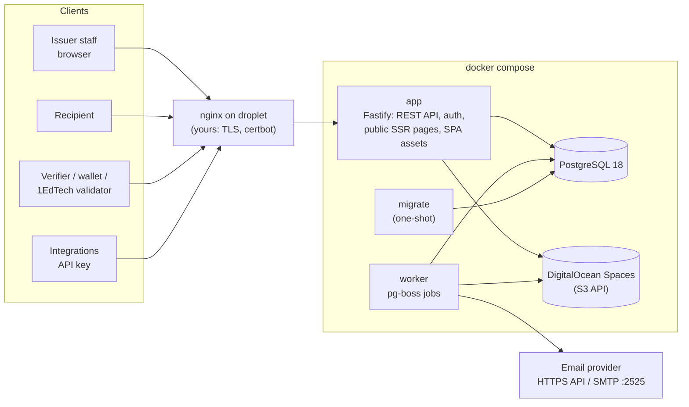
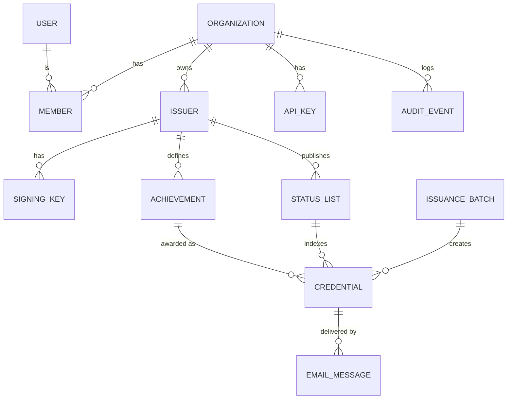

# credforge: Design Plan

**Status:** v0.3. M0 and M1 are done. M1's sample credentials passed the 1EdTech validator on 2026-10-14 (§17). M1 findings that changed the plan are folded into §4.2, §5.1, §6.1, §6.2, §9, §15 and §17.
**Date:** 2026-10-14
**Inputs:** `openbadges_platform_project_requirements.md` (first attempt), `branding/` (brand guide, copy kit, logo assets), and the 1EdTech Open Badges 3.0 spec (Final Release, document v1.4.5, June 29, 2026).

---

## 1. Product scope

**In one sentence:** credforge lets an organization create an achievement, award it to people using their email addresses, and give each recipient a signed Open Badges 3.0 credential that the recipient can view, share and download, and that anyone can verify.

### The core loop (the MVP must get this right)

1. An organization signs up and sets up its issuer profile (name, logo, website, contact).
2. It creates an **achievement** (name, description, criteria, image, skills/tags).
3. It **awards** that achievement to one recipient, or to many via CSV (name + email).
4. credforge builds and signs one OB 3.0 credential per recipient and emails each recipient a link.
5. The recipient opens the link and sees their badge page. They can download the baked PNG or the JSON, add it to LinkedIn, and share it.
6. Anyone with the link, JSON or image sees who issued it, to whom, what was earned, when, its current status, and the results of the proof checks.
7. The issuer can revoke a credential. The new status shows on the public page and in the signed status list.

### Users

| User | Needs an account? | What they do |
|---|---|---|
| **Issuer staff** (org members) | Yes | Create achievements, award, revoke, manage org |
| **Recipient** | **No.** The emailed link is enough | View, download, share, hide their credential |
| **Verifier** | No | Open the link or upload the badge, then read the verification result |
| **Platform admin** | Yes (instance-level flag) | Operates the instance: approves and suspends orgs, sets limits, watches health |

### Two ways to deploy, one codebase

- **Hosted instance** at `https://credforge.app`. You run it for many organizations.
- **Self-hosted.** Anyone runs their own instance with `docker compose up`.

So the code never hard-codes `credforge.app`. Every URL is built from `PUBLIC_BASE_URL`.

---

## 2. Key decisions at a glance

| Area | Decision | Why |
|---|---|---|
| Language/runtime | **TypeScript end to end, Node.js 24 LTS** | The most mature Data Integrity / VC libraries are JavaScript (Digital Bazaar's `@digitalbazaar/vc`, `eddsa-rdfc-2022-cryptosuite`, bitstring status list). One language covers the API, UI, worker and credential engine. |
| Server | **Fastify 5** with **Zod** schemas, generating **OpenAPI 3.1** | API-first. Every request and response is schema-validated, and the API docs are generated from the same schemas. |
| Issuer UI | **React 19 SPA** (Vite) with TanStack Router/Query, **Tailwind CSS v4** and **shadcn/ui** (Radix primitives) | The admin UI is just another client of the public REST API (dogfooding), so the API is guaranteed to be complete. Radix gives accessible components. |
| Public pages | **Server-rendered HTML** (React SSR) from the same Fastify app | Link previews on LinkedIn/Slack need server-side Open Graph tags. Verifiers without JavaScript still work, and pages are fast and printable. |
| Auth | **Better Auth**: email+password, **Continue with Google** and **Microsoft**, email verification, TOTP MFA, organizations with roles and invitations, magic links. Per-org enterprise SSO (OIDC/SAML) later. | A maintained, framework-agnostic library that covers most of the auth, federated sign-in and multi-tenant plumbing. |
| Database | **PostgreSQL 18** with **Drizzle ORM** and SQL migrations | Relational core. JSONB holds signed credentials. Migrations are typed and reviewable. |
| Background jobs | **pg-boss** (a queue stored in Postgres). **No Redis.** | One less stateful service to run and back up on a droplet. Jobs are enqueued in the same transaction as the data. |
| File storage | **DigitalOcean Spaces** (S3 API) for credforge.app; a local volume for self-hosters and offline dev | You already run Spaces. It is durable and off the droplet, and supports per-bucket access keys. |
| Email | **SendGrid v3 Web API** (HTTPS) is the primary transport. Generic SMTP (nodemailer) is the fallback for self-hosters. | **DigitalOcean blocks outbound SMTP on ports 25/465/587** on droplets ([DO docs](https://docs.digitalocean.com/support/why-is-smtp-blocked/)). An HTTPS API isn't affected. |
| Proof format (MVP) | **Data Integrity `DataIntegrityProof` with `eddsa-rdfc-2022` (Ed25519)** | This is the spec's Linked Data proof format. The 1EdTech conformance suite currently supports only this cryptosuite for that format. |
| Proof format (later) | VC-JWT with **RS256** (the spec's minimum algorithm) | Optional second format for consumers that prefer JWTs. |
| Issuer identity | **HTTPS URL**: `{PUBLIC_BASE_URL}/issuers/{id}`, which publishes Multikey verification methods | Spec §8.5: verifiers are only *required* to support HTTP URLs. This matches the spec's own examples. |
| Revocation | **W3C Bitstring Status List** (`BitstringStatusListEntry`) | This is the status type that the OB 3.0 verification algorithm (§9.1) checks. |
| Recipient identity | **Salted SHA-256 hashed email** (`IdentityObject`, `identityType: emailAddress`), plus the recipient's name | The email address never appears in plain text in the credential or on public pages. |
| Containers | **One image, three roles** (`app`, `worker`, `migrate`) plus `postgres`. The app binds to `127.0.0.1:3000`. | Your nginx proxies to a single upstream. |
| Signup (credforge.app) | **Approval required.** Orgs can sign up and set up, but can't award to anyone else until a platform admin approves them. | The strongest protection against impersonation and phishing on a public instance. |
| License | **Apache-2.0** | Permissive and includes a patent grant; best for adoption. |

---

## 3. Refinements to the original requirements

**Kept:** the vision, the three user types, standards alignment, the split between credential data and presentation, and the initial-release acceptance criteria.

**Changed or added:**

1. **Badges come first. A certificate is a view, not a separate product.** A certificate is a printable layout of the *same* signed credential. The MVP ships a print-optimized HTML certificate page (the browser's "Save as PDF" produces the PDF). A certificate designer and server-generated PDFs come in phase 2. The separate `BadgeTemplate`/`CertificateTemplate` entities are dropped.
2. **No Redis.** A Postgres-backed queue (pg-boss) covers background jobs. Rate limits live in memory on a single node, or in Postgres.
3. **Roles simplified from 5 to 4 org roles** (`owner`, `admin`, `issuer`, `viewer`), plus an instance-level platform admin. "Template designer" folds into `issuer`. Checks are permission-based, so roles can be added later without rewrites.
4. **Organization vs. issuer is explicit.** An *Organization* is the tenant and membership boundary. It owns one or more *Issuers*; each issuer is an OB `Profile` with its own keys and branding. The MVP UI creates one issuer per org, but the schema already allows several (for departments).
5. **Concrete standards choices replace "support VC concepts":** DI `eddsa-rdfc-2022`, Bitstring Status List, hashed email identity, PNG/SVG baking, and JSON-LD contexts pinned offline.
6. **Trust and anti-abuse controls are added.** A public hosted instance needs them. Without them, anyone could create an issuer named "Harvard" and send phishing emails through credforge. See §6.3.
7. **Deployment facts are written down:** `PUBLIC_BASE_URL` can never change, DigitalOcean blocks SMTP, and the master key needs its own backup.
8. **Explicitly post-MVP:** Kubernetes/Helm, SSO, sub-organizations, OB 2.0 import, webhooks, analytics, LMS integrations.
9. **Product claims follow the brand guardrails.** Don't claim "1EdTech certified", "analytics" or "integrations" until they exist. Certification is a goal, not a claim.
10. **Clean-up:** removed the stray citation tokens (`citeturn…`). The brand spells the name in lowercase: **credforge**.
11. **Federated sign-in is in the MVP** (Google and Microsoft), not a later phase. Per-org enterprise SSO (OIDC/SAML) stays in phase 2. See §6.4.
12. **Storage is concrete:** DigitalOcean Spaces, with permanent image URLs on the credforge.app domain so the storage provider can change without breaking issued credentials. See §5.4 and §13.5.

---

## 4. Architecture



### 4.1 Modules inside the app

It is one deployable with clearly separated modules:

| Module | Responsibility |
|---|---|
| `auth` | Better Auth: sessions, MFA, email verification, magic links |
| `orgs` | Organizations, members, roles, invitations |
| `issuers` | Issuer profiles, signing keys, domain verification, public profile documents |
| `achievements` | Achievement definitions, images, revisions |
| `issuance` | Single awards, CSV batches, drafts, idempotency |
| `credentials` | Lifecycle: issued, revoked, reissued, visibility |
| `delivery` | Email rendering and sending, claim tokens, delivery status |
| `public` | SSR pages and content negotiation (HTML vs. JSON) |
| `verify` | Verifying a URL, JSON or baked image |
| `status-lists` | Allocating indexes, flipping bits, signing and publishing lists |
| `audit` | Append-only event log |
| `api-keys` | Scoped keys for integrations |
| `files` | Upload validation, image processing, storage drivers |
| `platform` | Instance admin: orgs, limits, suspensions, queue and email health |

### 4.2 `packages/ob3`: the credential engine

This is a pure library with **no database and no HTTP**. It is where standards correctness lives, so it gets the most tests.

- Builds an `OpenBadgeCredential` from typed inputs.
- Validates output against the official OB 3.0 JSON Schema.
- Signs and verifies with `DataIntegrityProof` / `eddsa-rdfc-2022`.
- Hashes and checks recipient identifiers (`sha256$…` + salt).
- Bakes and extracts credentials in PNG (`iTXt` chunk, keyword `openbadgecredential`) and SVG (`<openbadges:credential>`).
- Encodes and decodes Bitstring Status Lists (GZIP + multibase).
- **Pinned JSON-LD document loader.** The contexts ship inside the package as byte-for-byte copies with recorded hashes: VCDM 2.0, OB 3.0.3, the OB 3.0 extensions context, W3C Controlled Identifiers v1.0, Multikey v1 and Data Integrity v2. The loader never fetches anything over the network, for security and reliability; issuer profiles are handed to it by the caller.
- Exposes a `Signer` interface, so the in-process key signer can later be swapped for a KMS or HSM.
- Verifies through two independent paths in its tests: Digital Bazaar's verifier, and a second verifier that shares no code with signing (a different JSON-LD processor and RDF canonicalizer, `node:crypto` for Ed25519).

Details, usage and the validator procedure are in `packages/ob3/README.md`.

---

## 5. Open Badges 3.0 credential design

### 5.1 What an issued credential looks like

```json
{
  "@context": [
    "https://www.w3.org/ns/credentials/v2",
    "https://purl.imsglobal.org/spec/ob/v3p0/context-3.0.3.json",
    "https://purl.imsglobal.org/spec/ob/v3p0/extensions.json"
  ],
  "id": "https://credforge.app/credentials/0b6f3c1e-5d0a-4b8e-9c55-1c2f7e3d9a10",
  "type": ["VerifiableCredential", "OpenBadgeCredential"],
  "name": "Intro to Network Defense",
  "issuer": {
    "id": "https://credforge.app/issuers/7f3e9a52-…",
    "type": ["Profile"],
    "name": "Example Cyber Academy",
    "url": "https://example.org",
    "image": { "id": "https://credforge.app/issuers/7f3e9a52-…/images/c41a9e….png", "type": "Image" }
  },
  "validFrom": "2026-11-02T15:04:05Z",
  "credentialSubject": {
    "type": ["AchievementSubject"],
    "identifier": [
      {
        "type": "IdentityObject",
        "identityType": "emailAddress",
        "hashed": true,
        "identityHash": "sha256$4d1c…",
        "salt": "Xk9q…"
      },
      {
        "type": "IdentityObject",
        "identityType": "name",
        "hashed": false,
        "identityHash": "Jordan Rivera"
      }
    ],
    "achievement": {
      "id": "https://credforge.app/achievements/2a91c4d0-…",
      "type": ["Achievement"],
      "achievementType": "Badge",
      "name": "Intro to Network Defense",
      "description": "Recognizes foundational skills in defending small networks.",
      "criteria": { "narrative": "Completed all six labs and scored 80% or higher on the final assessment." },
      "image": { "id": "https://credforge.app/achievements/2a91c4d0-…/images/9f2c7b….png", "type": "Image" },
      "tag": ["networking", "security"]
    }
  },
  "credentialStatus": {
    "id": "https://credforge.app/status/7f3e9a52-…/1#48213",
    "type": "BitstringStatusListEntry",
    "statusPurpose": "revocation",
    "statusListIndex": "48213",
    "statusListCredential": "https://credforge.app/status/7f3e9a52-…/1"
  },
  "credentialSchema": [{
    "id": "https://purl.imsglobal.org/spec/ob/v3p0/schema/json/ob_v3p0_achievementcredential_schema.json",
    "type": "1EdTechJsonSchemaValidator2019"
  }],
  "proof": {
    "type": "DataIntegrityProof",
    "cryptosuite": "eddsa-rdfc-2022",
    "created": "2026-11-02T15:04:05Z",
    "verificationMethod": "https://credforge.app/issuers/7f3e9a52-…#z6Mk…",
    "proofPurpose": "assertionMethod",
    "proofValue": "z…"
  }
}
```

Optional fields filled when present: `validUntil` (expiry), `evidence[]` (URL, name, narrative), `achievement.alignment[]` and skill tags, `credentialSubject.result[]`.

Details settled in M1 (the full signed example is `packages/ob3/test/fixtures/golden/credential.signed.json`):

- **The third `@context`, `…/ob/v3p0/extensions.json`, is required.** It is the only context that defines `1EdTechJsonSchemaValidator2019`, the `credentialSchema` type. Without it that type is an undefined term, and eddsa-rdfc-2022 canonicalization (JSON-LD safe mode) refuses to sign. The OB 3.0 spec's own examples include it, and the 1EdTech validator bundles it.
- **`statusListIndex` is a string**, as Bitstring Status List v1.0 requires. The OB 3.0 examples show a number; the 1EdTech validator reads both, and so does credforge's verifier.
- **`proof` is a single object**, as Digital Bazaar's library writes it (the schema allows an object or an array).
- **`identityHash`** is `sha256$` + hex of SHA-256 over the UTF-8 bytes of the normalized email followed by the salt. Normalization is trim, Unicode NFC and lowercase. The salt is 16 random bytes, base64url-encoded. This matches the spec's example vector (`a@example.com` + `Kosher`).

### 5.2 Rules

- **Signed credentials are immutable.** Any change, including fixing a typo in the name, means **reissue**: a new credential is created, and the old one is revoked with reason `superseded` and linked to the new one.
- **Editing an achievement never touches issued credentials.** Each credential embeds the achievement as it was at issue time. The achievement URL serves the current revision.
- **Self-check before saving.** Every newly signed credential is verified and schema-validated before it is stored. A signing bug therefore fails loudly instead of producing bad credentials.
- **Every public URL is permanent.** That covers issuers, achievements, credentials and status lists. IDs are random UUIDs, so recipients can't be discovered by guessing URLs.
- **Content negotiation on permanent URLs.** Browsers get HTML. `Accept: application/vc`, `application/ld+json` or `application/json` get the signed JSON. Explicit `.json` download links are provided too.

### 5.3 What the recipient gets

- A hosted credential page at the credential's `id` URL
- A baked **PNG** (and a baked **SVG** if the achievement image is SVG). Any OB 3.0 tool can extract the credential from the image.
- The signed **JSON** file
- **Add to LinkedIn** (LinkedIn's "add certification" URL with name, issuer, date, URL and credential ID)
- A **printable certificate** view
- *Phase 2–3:* push to digital wallets (see the roadmap)

### 5.4 Badge images

**What issuers can upload:**

- PNG, SVG, JPEG or WebP, up to 2 MB. JPEG and WebP are converted to PNG, because OB 3.0 defines baking only for PNG and SVG.
- Square artwork, at least 400×400 px, is recommended. Transparent backgrounds are fine. Anything larger than 2048 px is scaled down.
- Every upload is checked and cleaned on the server before it is stored (§12).
  - SVGs are sanitized.
  - Raster images are re-encoded losslessly, which strips metadata.

**Images generated at upload time:**

| Image | Used for |
|---|---|
| Original (cleaned) | The image in the credential, and baking |
| 512 px PNG | Credential pages and **emails** (most email clients don't display SVG) |
| 128 px PNG | Lists and tables in the issuer app |
| 1200×630 card | Link previews on LinkedIn, Slack and other sites (Open Graph): the badge on a branded background with the achievement name |

**Rules that keep issued credentials intact:**

- **Image URLs in credentials always point at credforge.app, never at the storage provider.** An example is `https://credforge.app/achievements/{id}/images/{hash}.png`. Images can later move off Spaces without breaking a single issued credential.
- **Image URLs are content-addressed**, meaning the URL contains the file's hash, so the bytes behind a URL never change. If an issuer replaces a badge image, the achievement gets a *new* URL. Credentials issued earlier keep pointing at the image they were issued with.
- **Images referenced by any issued credential are never deleted.** The code enforces this.
- **Baked badges are created on request, not stored.** Baking only inserts a text chunk into the PNG (no re-encoding), so it's fast. Storing a baked copy per credential would multiply storage for every 10,000-row batch. Responses are cached.

---

## 6. Identity, keys and trust

### 6.1 Issuer identifiers and key discovery

- Issuer `id` = `{PUBLIC_BASE_URL}/issuers/{uuid}`. Requesting it as JSON returns the OB `Profile`, which also works as a controller document. It lists each published key as a `Multikey` verification method (`publicKeyMultibase` starting with `z6Mk…`) and references it from `assertionMethod`. Requesting it as HTML returns the public issuer page.
- Proofs use `verificationMethod: "{issuerId}#{publicKeyMultibase}"`, the same pattern as the spec examples.
- `did:web` (`did:web:credforge.app:issuers:{uuid}`) is a possible later option but not MVP.
- **Interop risk settled in M1.** The profile document's shape is pinned down and tested:

  ```json
  {
    "@context": [
      "https://www.w3.org/ns/credentials/v2",
      "https://purl.imsglobal.org/spec/ob/v3p0/context-3.0.3.json",
      "https://www.w3.org/ns/cid/v1"
    ],
    "id": "https://credforge.app/issuers/7f3e9a52-…",
    "type": ["Profile"],
    "name": "Example Cyber Academy",
    "url": "https://example.org",
    "verificationMethod": [{
      "id": "https://credforge.app/issuers/7f3e9a52-…#z6Mk…",
      "type": "Multikey",
      "controller": "https://credforge.app/issuers/7f3e9a52-…",
      "publicKeyMultibase": "z6Mk…"
    }],
    "assertionMethod": ["https://credforge.app/issuers/7f3e9a52-…#z6Mk…"]
  }
  ```

  - **The W3C Controlled Identifiers v1.0 context (`https://www.w3.org/ns/cid/v1`) is needed.** Neither the VCDM 2.0 nor the OB 3.0 context defines `verificationMethod`, `assertionMethod`, `controller`, `Multikey` or `publicKeyMultibase`. Digital Bazaar's verifier processes the controller document as JSON-LD in safe mode, where undefined terms are errors. The three contexts combine without protected-term conflicts.
  - **Digital Bazaar's verifier** (`@digitalbazaar/vc` + `data-integrity` + `eddsa-rdfc-2022-cryptosuite`) dereferences the key id, then the controller document, and checks that `assertionMethod` lists the key and that the key's controller is the credential issuer. credforge's verifier serves both from the issuer profile; the key comes back with the Multikey context, which the key library requires.
  - **The 1EdTech validator** (`EmbeddedProofProbe` in its public source) reads the key straight from a `{controller}#z6Mk…` fragment and only checks that the controller equals `issuer.id`. It doesn't fetch the profile for the proof. Its fallback for other key URLs expects type `"MultiKey"` with a capital K, which never matches a conformant `Multikey`, so the fragment form is the one that works there. One consequence: it can't see a key that was revoked in the profile.
  - Shape rules both rely on: `verificationMethod` is an array, `assertionMethod` holds id strings, and each method's `controller` is exactly the issuer id.
  - The HTTPS-URL form verifies on both paths, so the `did:web` fallback isn't needed. The engine is id-agnostic and is tested with a `did:web` issuer too.

### 6.2 Key custody

- Each issuer gets an **Ed25519** key pair, generated server-side when the issuer is created. It is kept in Multikey form: `publicKeyMultibase` (`z6Mk…`) and `secretKeyMultibase` (`z3u2…`, the 32-byte seed), the format of the W3C test vectors.
- Private keys are **encrypted at rest** with AES-256-GCM under a **master key** from `CREDFORGE_MASTER_KEY` (or a Docker secret file). Leaking the database alone does not let anyone forge credentials.
- The master key is versioned (`kek_version`), so it can be rotated with a CLI command that re-encrypts all issuer keys.
- Private keys never leave the server process. They are never logged, never returned by the API, and never exported in the MVP.
- **Key states:**
  - `active`: signs new credentials.
  - `retired`: still published, so older credentials keep verifying.
  - `revoked`: removed from `assertionMethod`, so credentials it signed fail verification. The UI then offers a bulk reissue.
- Org owners can rotate keys from the UI. A CLI command does the same.

### 6.3 Trust and anti-impersonation (hosted instance)

- **Issuer domain verification.** The issuer proves it controls its website domain with a DNS TXT record (`_credforge.example.org TXT "credforge-verify=…"`) or a file at `/.well-known/credforge-verify.txt`. Public pages then show "Website verified: example.org". Unverified issuers show their website as *self-reported*. The wording stays precise, per the brand guardrails.
- **Approval gate** (`SIGNUP_MODE=approval`, the credforge.app setting). A new org starts as `pending`. It can complete its issuer profile, create achievements and **test-award to its own members' verified email addresses**, so it still gets to its first badge quickly. Awarding to anyone else waits until a platform admin approves the org. The admin gets a queue of pending orgs showing name, website, domain-verification status and requester; the org is emailed when it is approved or declined. Self-hosters usually choose `open` or `invite`.
- **Daily send cap.** A per-org daily cap (`DEFAULT_ORG_DAILY_SEND_LIMIT`) is a second guard even after approval, in case an account is compromised. Platform admins can raise it per org.
- **Suspension.** A platform admin can suspend an org, which stops all issuing and emailing. Existing credentials stay verifiable unless they are revoked for abuse.
- **Report abuse.** Every public credential page has a "Report a problem" link.
- **No spoofing in email.** Award emails are sent from the credforge domain, with the display name "Example Academy via credforge" and `Reply-To` set to the issuer's contact address. They never pretend to come from the issuer's domain (DMARC).

### 6.4 Sign-in and federated identity

This covers issuer staff and platform admins. Recipients still need no account. When the "My badges" page arrives (phase 2), it will offer the same sign-in buttons.

| Sign-in method | When | Notes |
|---|---|---|
| Email + password | M2 | Email verification required |
| **Continue with Google** | M2 | OpenID Connect, basic scopes only (`openid email profile`) |
| **Continue with Microsoft** (work, school and personal accounts) | M2 | Most schools and companies run on Microsoft 365. Little extra work once Google works. |
| GitHub | Optional, configuration only | Useful for developer and CTF communities |
| Enterprise SSO per org (OIDC or SAML, e.g. "acme.edu staff must use Acme's Okta") | Phase 2 | Better Auth SSO plugin, tied to the org's verified domain (§6.3) |
| Passkeys | Phase 2 | As a sign-in method and as a second factor |

A provider is switched on only when its client ID and secret are configured, so self-hosters enable just the ones they want.

**How sign-in methods attach to people:**

- One credforge user can have several sign-in methods: password, Google, Microsoft. Their memberships, roles and audit history are the same whichever one they use.
- **Signing up with Google** creates a user whose email counts as verified, because Google vouches for it (`email_verified`).
- **Microsoft caveat:** for multi-tenant apps, Microsoft's `email` claim is *not* verified. Anyone who runs their own Entra tenant can put any address there; this is the "nOAuth" account-takeover issue. credforge trusts a Microsoft email only when the `xms_edov` claim (email domain owner verified) is true. Otherwise it sends its own verification email before the account can do anything.
- **No silent account merging** (`disableImplicitLinking`). Say someone already has a password account for `jordan@acme.edu` and clicks "Continue with Google". They are told to sign in the usual way and connect Google under **Settings → Sign-in methods**. This closes the main takeover path for federated login. A method can be disconnected as long as at least one remains.
- **Provider tokens are not kept.** credforge only needs to know who signed in. A database hook strips the Google/Microsoft access and refresh tokens before the account record is saved, so nothing can act on the user's Google account later.
- **Invitations** to `jordan@acme.edu` can be accepted by signing in with any method whose verified email matches.

**Two-step verification and federated sign-in:**

- Better Auth enforces its two-factor check only on password sign-in. Google and Microsoft sign-ins skip it by default.
- credforge can't tell whether someone's Google account uses 2-step verification. So on credforge.app, **owners and admins must pass a credforge second factor (TOTP) after *any* sign-in method**. This is a small custom hook in the `auth` module, with tests. Issuers and viewers are encouraged to enable it, but it isn't required.
- Later, enterprise SSO connections that report MFA in the token (`amr` claim) can be trusted instead.

**Setup for credforge.app** (a checklist goes in the deployment guide):

- **Google Cloud:**
  - Configure the OAuth consent screen: External; name "credforge"; logo; homepage `https://credforge.app`; **privacy policy and terms URLs**; authorized domain `credforge.app`.
  - Create a Web OAuth client with redirect URI `https://credforge.app/api/auth/callback/google`.
  - Basic scopes need no Google security review. Showing the credforge name and logo on the consent screen requires brand verification, which needs the privacy policy and proof that you own `credforge.app`.
- **Microsoft Entra:**
  - Register an app for any organizational directory and personal accounts.
  - Redirect URI: `https://credforge.app/api/auth/callback/microsoft`.
  - Add the optional claim `xms_edov`.
  - Publisher verification (needs a Microsoft Partner Network ID) removes the "unverified" label. It's optional.
- **Development:** separate dev OAuth clients with `http://localhost:3000/api/auth/callback/…` redirect URIs.

---

## 7. Domain model



| Entity | Key fields | Notes |
|---|---|---|
| `user`, `session`, `account`, `verification`, `two_factor` | (managed by Better Auth) + `is_platform_admin` | |
| `organization` | name, slug, `status` (pending / active / suspended / declined), `approved_by`, `approved_at`, `daily_send_limit` | Tenant boundary |
| `member` / `invitation` | org, user/email, `role` | owner · admin · issuer · viewer |
| `issuer` | **uuid (public)**, org, name, description, url, email, logo, accent color, `domain`, `domain_verified_at` | The OB `Profile` |
| `signing_key` | issuer, algorithm, public key (multibase/JWK), **encrypted private key**, `kek_version`, `status`, timestamps | |
| `achievement` | **uuid (public)**, issuer, name, description, criteria (narrative / url), `achievement_type`, image, tags, alignments (jsonb), default validity period, `revision`, `status` (draft / active / archived) | |
| `credential` | **uuid (public)**, org, issuer, achievement + revision, batch, `recipient_email` (normalized), `recipient_name`, `email_salt`, `status` (draft / issued / revoked), `valid_from`, `valid_until`, **`document` (signed VC, jsonb)**, `signing_key_id`, status list + index, evidence, custom fields, `visibility`, `claim_token_hash`, `accepted_at`, revocation reason/time, `replaced_by_id`, issued_by (user or API key) | "Expired" is computed from `valid_until`, never stored |
| `issuance_batch` | org, achievement, source (csv / api), file, column mapping, `status`, counts, per-row results | |
| `status_list` | issuer, purpose, size (131,072 entries), bitstring, allocation state, `version`, published signed document | Indexes are assigned **randomly**, which gives recipients herd privacy |
| `email_message` | org, credential, kind, recipient, provider message ID, `status` (queued / sent / delivered / bounced / failed), attempts, error | Drives the delivery status the issuer sees |
| `email_template` | org/issuer, kind, subject, body (limited Markdown) | Defaults ship with the app |
| `api_key` | org, name, `prefix`, **hash**, scopes, last used, expiry, revoked | The key is shown once |
| `audit_event` | org, actor (user / api_key / system / recipient), action, target, IP, user agent, data, time | **Append-only:** the app's database role cannot UPDATE or DELETE |
| `file` | org, kind (issuer logo / badge image / CSV import / export), storage driver + bucket + key, MIME type, size, **sha256**, dimensions, derived variants, `visibility` (public / private), `retain` (set once an issued credential references it) | Public images are content-addressed (§5.4) |

**Tenant isolation:** every tenant-owned row has `org_id`. The data-access layer requires an org scope on every query. An integration test tries cross-tenant access against **every** endpoint. Postgres row-level security is a defense-in-depth hardening item.

---

## 8. Key flows

### 8.1 Onboarding: "time to first badge" under 5 minutes

Sign up → verify email → name your organization → issuer profile (name, website, logo, contact email) → *(optional)* verify your domain → create your first achievement → award it to yourself as a test → see exactly what your recipients will see.

On credforge.app the org is *pending* during all of this. A banner explains that awarding to other people opens once the org is approved; verifying the domain makes approval faster. Approval emails the org owner, and a platform admin can approve or decline from the Platform screen.

### 8.2 Award one

Choose an achievement → enter the recipient's name and email (optional: evidence, issue date, expiry) → **preview** the badge page and the email → **Award**.
On the server, one transaction validates the input, allocates a status-list index, builds the credential, signs it, self-verifies it, inserts it, writes the audit event, and enqueues the email and image-baking jobs. Signing a single credential takes milliseconds, so it happens synchronously.

### 8.3 Award many (CSV)

Upload a CSV (MVP limit: 10,000 rows / 5 MB, with a downloadable template) → map columns (auto-detected) → **validation report** (invalid emails, duplicates within the file, people who already hold this achievement) → confirm → the batch job runs in chunks and is idempotent per row → live progress → results CSV (each row gets a credential URL or an error).

### 8.4 Delivery and claim (no recipient account)

- The email ("Example Academy awarded you Intro to Network Defense") links to `/credentials/{id}?t={claimToken}`.
- A valid token marks the credential *accepted* and unlocks owner actions: download PNG/JSON, add to LinkedIn, and **hide or show** the public page.
- Without the token, visitors see the public view.
- Claim tokens are 256-bit random values, stored hashed, valid for 90 days, and can be re-sent.
- Issuers see each credential's delivery status: queued → sent → delivered/bounced → opened.
- **SendGrid specifics:**
  - Mail is sent through the v3 Mail Send API.
  - **Click tracking and open tracking are turned off** on award emails, so claim tokens never pass through SendGrid's redirect domain. "Opened" is recorded when the recipient first visits the claim link, a first-party signal that is more accurate than a tracking pixel.
  - Delivered, bounce, dropped and spam-report statuses arrive through SendGrid's **signed Event Webhook** at `/api/webhooks/sendgrid`. The app checks the ECDSA signature before trusting an event.
  - Hard bounces are flagged on the credential so the issuer can fix the address and reissue.

### 8.5 Verify

- **Three entry points:** the credential URL, the `/verify` page (paste a URL or JSON, or upload a baked PNG/SVG), and `POST /api/v1/verify`.
- **Each check is shown separately:**
  1. Format and schema are valid.
  2. The signature checks out with a key published by this issuer.
  3. The credential is not revoked (status list checked at {time}).
  4. The current date is within the validity period.
  5. *Optional:* "Is this credential for `someone@example.com`?" (salted-hash comparison; the email is not stored).
- The wording is factual ("Signature checked") and never overclaims ("Guaranteed authentic").

### 8.6 Revoke and reissue

- **Revoke** one or many credentials, with a required internal reason and an optional public one. This flips the bit in the status list, and the worker re-signs and republishes the list (debounced by a few seconds). The public page then shows "Revoked on {date}".
- **Reissue** creates a corrected copy. The old credential is revoked as `superseded`, the two are linked, and the recipient is emailed.

### 8.7 Award through the API

`POST /api/v1/credentials` with `Authorization: Bearer cf_…` and an `Idempotency-Key` header. It uses exactly the same validation and signing path as the UI.

---

## 9. URL map (single origin, single upstream port)

| Path | Purpose | Notes |
|---|---|---|
| `/` | Landing page (brand site) | `LANDING_PAGE=false` redirects to `/login`, for self-hosters |
| `/login`, `/signup`, `/reset-password`, `/invite/:token` | Auth screens | |
| `/app/*` | Issuer admin SPA | |
| `/issuers/:id` | Issuer page (HTML) or Profile (JSON) | **Permanent**, embedded in credentials |
| `/issuers/:id/images/:hash.png` | Issuer logo | **Permanent**, immutable, served from Spaces through the app |
| `/achievements/:id` | Achievement page (HTML) or JSON | **Permanent** |
| `/achievements/:id/images/:hash.{png,svg}` (+ `-512.png`, `-128.png`, `-og.png`) | Badge image and its derived sizes | **Permanent**, immutable, served from Spaces through the app |
| `/credentials/:id` | Credential page (HTML) or signed VC (JSON) | **Permanent**; `?t=` claim token |
| `/credentials/:id/badge.png`, `badge.svg`, `credential.json` | Downloads | |
| `/credentials/:id/certificate` | Printable certificate | |
| `/status/:issuerId/:listId` | Signed `BitstringStatusListCredential` | Short cache TTL plus an `ETag`. Must be public JSON: the 1EdTech validator fetches and verifies it for every credential with a status entry, about 10 times per check, so rate limits must not block repeated fetches |
| `/verify` | Verification tool | |
| `/api/v1/*` | REST API | |
| `/api/auth/*` | Better Auth endpoints, including the Google/Microsoft callbacks (`/api/auth/callback/{provider}`) | |
| `/api/webhooks/sendgrid` | SendGrid Event Webhook | Signature-verified, rate-limited |
| `/api/docs` | Interactive OpenAPI docs | |
| `/healthz`, `/readyz` | Health checks | |

---

## 10. REST API (v1)

**Conventions:** JSON; an OpenAPI 3.1 spec generated from the Zod schemas; cursor pagination; `Idempotency-Key` on every create; errors as RFC 9457 `problem+json`; API keys with scopes; rate limits per key. The SPA uses the same endpoints with its session cookie.

| Resource | Endpoints |
|---|---|
| Issuers | `GET/PATCH /issuers/{id}` · `POST /issuers/{id}/keys/rotate` · `POST /issuers/{id}/domain-verification` |
| Achievements | `GET/POST /achievements` · `GET/PATCH /achievements/{id}` · `POST /achievements/{id}/archive` |
| Credentials | `GET/POST /credentials` · `GET /credentials/{id}` · `POST /credentials/{id}/revoke` · `/reissue` · `/resend` |
| Batches | `POST /batches` (CSV or JSON rows) · `GET /batches/{id}` · `POST /batches/{id}/confirm` · `GET /batches/{id}/results.csv` |
| Verify | `POST /verify` |
| Org admin | `/members` · `/invitations` · `/api-keys` · `GET /audit-events` |
| Export | `GET /exports/credentials.csv` · `GET /exports/credentials.jsonl` |

*Phase 3:* the 1EdTech **Open Badges API** (the OB 3.0 REST/OAuth 2.0 API for hosts and wallets).

---

## 11. UI/UX plan

### 11.1 Issuer app (sidebar layout)

- **Dashboard:** awards this month, % accepted, revoked count, recent activity, and a prominent **Award a badge** button.
- **Achievements:** a grid of badge cards. Create/edit has a **live preview** of the recipient's page.
- **Award:** a single-award form and the CSV wizard.
- **Credentials:** a table you can search by name or email and filter by achievement, status, batch or date. The detail drawer shows a timeline (issued → emailed → delivered → opened → revoked).
- **Issuer profile and branding:** logo, accent color, description, website and domain verification.
- **Settings:** members and roles, API keys, email templates, signing keys, audit log, export.
- **Platform** (instance admins only): orgs, approvals and limits, suspensions, queue and email health.

### 11.2 Public pages

- **Credential page:** the badge image is the hero, followed by "**Intro to Network Defense**, awarded to Jordan Rivera by Example Cyber Academy". Then the issue date and a status pill, followed by criteria, description, skills and evidence. A verification panel lists each check. Actions: share, LinkedIn, download.
- **Issuer page, `/verify` tool, landing page.**
- Issuer branding (logo, accent) leads. credforge stays in the background ("Hosted on credforge").

### 11.3 Applying the brand

- **Tokens:** ink `#111827`, slate `#374151`, teal `#379392`, violet `#CA3CFF`, canvas `#FAFAFA`, shipped as a shared Tailwind theme in `packages/ui`.
- **Contrast check (computed against WCAG 2.2):**

  | Pair | Ratio | AA body text (4.5:1) |
  |---|---|---|
  | Ink on canvas | 17.0 | ✅ |
  | Slate on canvas | 9.88 | ✅ |
  | Teal on ink | 4.86 | ✅ |
  | Violet on ink | 4.73 | ✅ |
  | Violet on canvas | 3.59 | ❌ (large text only) |
  | Teal on canvas | 3.50 | ❌ (large text only) |
  | White on teal | 3.65 | ❌ (a white-on-teal button fails) |

  This matches the brand guide's own usage rule. On light surfaces, primary buttons use **ink** (as the brand's website mock already does). For small text and links on light backgrounds there are **derived accessible shades**: teal-700 `#2B7473` (5.23:1 on canvas; white on it is 5.46:1) and violet-700 `#9A1FCC` (5.85:1). The base brand colors stay for large display type, icons and shapes.
- **Semantic colors are missing from the brand.** The UI needs error/revoked (red), warning/expiring (amber) and success. They will be chosen to sit alongside the palette.
- **Typography:** **Segoe UI cannot be web-embedded** (Microsoft license) and isn't installed on macOS, iOS, Android or Linux. The UI uses the stack `"Segoe UI", system-ui, -apple-system, "Helvetica Neue", Arial, sans-serif`. Anything that must embed a font (server-rendered badge art, certificates, PDFs) needs an open-licensed face. Candidates: **Selawik** (Microsoft's OFL metric-compatible Segoe UI fallback) or **Noto Sans**.
- **Graphic language** (angled lines, forge arc, shield point) is used sparingly on the landing and public pages, and not in the admin chrome.
- **Voice:** the UI says **Create** and **Award** (the brand's verbs), while the API and code use the spec term `issue`. No hype, no overclaiming.
- **Accessibility target:** WCAG 2.2 AA, checked automatically with axe in end-to-end tests. Light and dark themes in the admin.

---

## 12. Security and privacy

| Threat / area | Controls |
|---|---|
| Credential forgery | Private keys encrypted under the master key; signing only in the server; pinned JSON-LD contexts; self-verification before save |
| Tampering | DI proofs on credentials **and** on status lists |
| Cross-tenant access | Org scope enforced in the data layer, cross-tenant test suite, RLS as hardening |
| Account takeover | Better Auth; strong password hashing; login rate limits; TOTP MFA (encouraged for all, **required for owners/admins** on the hosted instance); email verification before any award |
| CSRF | SameSite=Lax HttpOnly Secure cookies, Origin checks on state-changing requests, no credentialed CORS |
| API keys | Shown once, stored hashed, scoped, revocable, last-used tracking |
| Malicious uploads | Size limits; file-type check by magic bytes; raster images re-encoded with `sharp` (which strips metadata); **SVG sanitized** (no scripts, `foreignObject` or external references); served with `nosniff` and a sandbox CSP |
| Federated sign-in | No silent account merging; Microsoft email trusted only with `xms_edov`; provider tokens not stored; OAuth state and PKCE handled by Better Auth; owners/admins pass a credforge second factor after any sign-in method (§6.4) |
| Stored files | Spaces buckets fully private (no public objects or listing); per-bucket limited access keys; exports downloaded through the app after a permission check; images referenced by credentials never deleted; bucket versioning on (§13.5) |
| CSV | Streaming parser and row limits; formula-injection escaping on export |
| Email | No raw HTML from issuers (a limited Markdown subset, escaped); provider API or nodemailer (no header injection); SendGrid click/open tracking off, so tokens never pass through third-party redirects; webhook signatures verified |
| HTTP | Strict nonce-based CSP on SSR pages, `Referrer-Policy`, `frame-ancestors 'none'`; HSTS set at nginx |
| Abuse | Org approval gate, rate limits (auth, claim, verify, API), per-org daily send caps, suspension, report link, domain verification |
| Recipient privacy | Email only as a salted hash in credentials, never on public pages; recipients can hide their page; random status-list indexes; PII deletion (removes email and name while keeping revocation working); retention settings |
| Accountability | Append-only audit log of every change, visible to org admins and exportable |
| Supply chain | Lockfile; Renovate; `pnpm audit`; Trivy image scan in CI; non-root container; minimal base image |
| Secrets | `.env` never committed; `*_FILE` variants for Docker secrets |

The hosted instance also needs a **privacy policy and terms of service** (content you provide, not code).

---

## 13. Deployment

### 13.1 `docker-compose.yml` (production shape)

```yaml
name: credforge

x-app: &app
  image: credforge:${CREDFORGE_VERSION:-latest}   # becomes a registry path once the repo is hosted
  build: .
  env_file: .env
  restart: unless-stopped

services:
  migrate:
    <<: *app
    command: ["node", "dist/migrate.js"]
    restart: "no"
    depends_on:
      db: { condition: service_healthy }

  app:
    <<: *app
    command: ["node", "dist/server.js"]
    ports: ["127.0.0.1:3000:3000"]   # only your host nginx can reach it
    volumes: ["uploads:/data/uploads"]   # only used with STORAGE_DRIVER=local
    depends_on:
      migrate: { condition: service_completed_successfully }
    healthcheck:
      test: ["CMD", "node", "dist/healthcheck.js"]
      interval: 15s

  worker:
    <<: *app
    command: ["node", "dist/worker.js"]
    volumes: ["uploads:/data/uploads"]   # only used with STORAGE_DRIVER=local
    depends_on:
      migrate: { condition: service_completed_successfully }

  db:
    image: postgres:18-alpine
    environment:
      POSTGRES_DB: credforge
      POSTGRES_USER: credforge
      POSTGRES_PASSWORD_FILE: /run/secrets/db_password
    volumes: ["pgdata:/var/lib/postgresql"]   # PG 18 images expect this mount point
    healthcheck:
      test: ["CMD-SHELL", "pg_isready -U credforge"]
      interval: 5s
    restart: unless-stopped

volumes:
  pgdata: {}
  uploads: {}
```

For local development, `compose.dev.yml` runs only the backing services: Postgres, and **Mailpit**, which catches all outgoing email and shows it in a web UI on `:8025`. The app itself runs on your machine with `pnpm dev`, which gives fast reloads; file watching inside containers is slow on Windows. In short: `pnpm infra:up`, then `pnpm dev`, then open `http://localhost:5173`.

### 13.2 Configuration (environment)

| Variable | Purpose |
|---|---|
| `PUBLIC_BASE_URL` | `https://credforge.app`. ⚠️ **Permanent:** it is embedded in every signed credential. |
| `CREDFORGE_MASTER_KEY` / `_FILE` | 32-byte key that encrypts issuer signing keys. ⚠️ **Back it up separately from the database.** |
| `DATABASE_URL` | Postgres connection string |
| `AUTH_SECRET` | Session signing secret |
| `TRUST_PROXY` | Trust `X-Forwarded-*` from your nginx (loopback) |
| `EMAIL_TRANSPORT` | `sendgrid` (credforge.app) · `smtp` (generic) · `log` (development: print to console) |
| `SENDGRID_API_KEY` / `_FILE` | Restricted key with only the Mail Send permission |
| `SENDGRID_WEBHOOK_PUBLIC_KEY` | Verifies Event Webhook signatures |
| `SMTP_URL` | For `smtp` transport, e.g. `smtp://…@smtp.provider.com:2525` |
| `EMAIL_FROM` | e.g. `credforge <awards@credforge.app>` |
| `STORAGE_DRIVER` | `s3` (credforge.app, DigitalOcean Spaces) or `local` (self-hosters, offline dev) |
| `S3_ENDPOINT`, `S3_REGION`, `S3_BUCKET` | e.g. `https://nyc3.digitaloceanspaces.com`, `nyc3`, `credforge-prod` |
| `S3_ACCESS_KEY_ID`, `S3_SECRET_ACCESS_KEY` / `_FILE` | Limited Spaces key: Read/Write/Delete on the app bucket only |
| `BACKUP_S3_BUCKET`, `BACKUP_S3_ACCESS_KEY_ID`, `BACKUP_S3_SECRET_ACCESS_KEY` / `_FILE` | Separate limited key, used only by the backup script |
| `GOOGLE_CLIENT_ID`, `GOOGLE_CLIENT_SECRET` / `_FILE` | Enables "Continue with Google" |
| `MICROSOFT_CLIENT_ID`, `MICROSOFT_CLIENT_SECRET` / `_FILE` | Enables "Continue with Microsoft" |
| `GITHUB_CLIENT_ID`, `GITHUB_CLIENT_SECRET` / `_FILE` | Optional |
| `REQUIRE_MFA_FOR_ADMINS` | `true` on credforge.app: owners/admins need a credforge second factor after any sign-in |
| `SIGNUP_MODE` | `approval` (credforge.app) · `open` · `invite` |
| `DEFAULT_ORG_DAILY_SEND_LIMIT` | Per-org daily award-email cap; platform admins can raise it per org; `0` disables it |
| `LANDING_PAGE` | `true` on credforge.app; self-hosters may disable it |
| `LOG_LEVEL`, `SENTRY_DSN` (optional) | Observability |

The app **refuses to start** if a required value is missing or malformed. It validates its configuration with Zod at boot.

### 13.3 DigitalOcean droplet + your nginx

- **Size:** 2 GB RAM minimum; 4 GB is comfortable.
- **Shipping images (no hosted repo yet):** build the image on your workstation, then stream it to the droplet with `docker save credforge:<ver> | ssh <droplet> docker load`. `deploy/ship.sh` wraps this. Don't build on a 2 GB droplet. Once the repo is hosted, CI builds and publishes to a registry and the droplet just pulls.
- **nginx** (an example config ships at `deploy/nginx.conf.example`): `proxy_pass http://127.0.0.1:3000;` and pass `Host`, `X-Forwarded-For` and `X-Forwarded-Proto`. Set `client_max_body_size 10m` for CSV and image uploads, and add HSTS. Use certbot for TLS.
- **Email:** ports 25/465/587 are blocked on droplets, so credforge.app uses the **SendGrid Web API over HTTPS**. Set up SendGrid **Domain Authentication** for credforge.app (CNAME records for DKIM and SPF alignment) and publish a **DMARC** record. Create a **restricted API key** (Mail Send only) and enable the **signed Event Webhook** pointing at `https://credforge.app/api/webhooks/sendgrid`.
- **Network:** a DigitalOcean Cloud Firewall allowing only 22 (restricted to your IP), 80 and 443. Postgres is never exposed. Add a DNS CAA record for Let's Encrypt.
- **Upgrades:** load the new image (or `docker compose pull` once there's a registry), then `docker compose up -d`. The `migrate` service runs before `app` and `worker` start.

### 13.4 What must never be lost

1. **The Postgres database:** credentials, encrypted keys, status lists, audit log.
2. **`CREDFORGE_MASTER_KEY`.** Without it, nothing new can be signed and **revocations stop working**, because status lists can't be re-signed.
3. **The `credforge-prod` Spaces bucket:** logos and badge art referenced by URL from issued credentials.
4. **The domain.** Every issued credential points at it.

**Backups:** a nightly `pg_dump` uploaded to the `credforge-backups` Space (off the droplet), plus droplet snapshots. Badge images are protected by Spaces durability and bucket versioning (§13.5). The repo includes the backup script and a **written restore drill**.

### 13.5 File storage: DigitalOcean Spaces

- **Driver:** the `s3` storage driver uses the AWS SDK v3 against `https://{region}.digitaloceanspaces.com`. The same driver works with any S3-compatible service. The `local` driver stays for self-hosters and offline development.
- **Region:** put the Spaces buckets in the **same region as the droplet**.
- **Buckets** (each Space is a bucket):

  | Bucket | Contents | Access |
  |---|---|---|
  | `credforge-prod` | Issuer logos, badge images and their derived sizes, CSV uploads, exports | **Private:** no public objects, no public listing. The app uses a limited key with Read/Write/Delete on this bucket only. **Versioning on**, so a deleted or overwritten object can be recovered. |
  | `credforge-backups` | Nightly database dumps | Private. A separate limited key is used only by the backup script. Old dumps expire through a lifecycle rule (e.g. 30 days). |
  | `credforge-dev` | Development and integration tests of the `s3` driver | Private, with a dev-only key |

- **Object keys:**

  ```text
  orgs/{orgId}/issuers/{issuerId}/logo/{sha256}.png
  orgs/{orgId}/achievements/{achievementId}/{sha256}/original.{png|svg}
  orgs/{orgId}/achievements/{achievementId}/{sha256}/512.png · 128.png · og.png
  orgs/{orgId}/imports/{batchId}.csv              (deleted after 30 days)
  orgs/{orgId}/exports/{exportId}.{csv|jsonl}     (deleted after 7 days)
  ```

  Imports and exports are cleaned up by a scheduled worker job, plus Spaces lifecycle rules where they apply.
- **Uploads go through the app, not straight from the browser to Spaces.** Every image has to be checked, sanitized and resized on the server anyway (§5.4), and badge images are small. This also means Spaces needs no CORS configuration.
- **Serving images:**
  - Public image URLs are handled by the app, which streams the object from Spaces with `Cache-Control: public, max-age=31536000, immutable`. That is safe because the URLs are content-addressed.
  - Your nginx can cache these responses (`proxy_cache`; an example is in `deploy/nginx.conf.example`), so repeat requests reach neither Node nor Spaces.
  - Later, if traffic warrants it, the Spaces CDN on a custom subdomain such as `assets.credforge.app` can sit in front. The URLs inside credentials don't change.
- **Private files** (CSV uploads, exports) are never public. They are downloaded through the app after a permission check.
- **Access keys** are created in the DigitalOcean control panel as *limited access keys* scoped to one bucket. They reach the containers as `_FILE` secrets. Rotate them by creating a new key, deploying it, then deleting the old one.
- **Development:** `compose.dev.yml` uses the `local` driver by default. Setting `STORAGE_DRIVER=s3` with the `credforge-dev` bucket exercises the real path. The `s3` driver's integration tests run against that bucket when its key is present.

---

## 14. Observability and operations

- Structured JSON logs (pino) with a request ID and org ID, and **no PII or secrets**.
- `/healthz` (process alive) and `/readyz` (database and queue reachable). Optional Prometheus `/metrics` on an internal port. Optional Sentry.
- Job retries with exponential backoff. Failed jobs are visible and retryable in the platform admin.
- **CLI** (`docker compose exec app node dist/cli.js …`): create a platform admin, rotate the master key, rotate an issuer key, republish status lists, verify a credential, export data.

---

## 15. Testing and conformance

- **`packages/ob3`:** unit tests and golden fixtures. Every credential produced in tests is **verified twice**: by Digital Bazaar's verifier, and by an independent test verifier that shares no code with the signing path (`jsonld-streaming-parser` and `rdfjs-c14n` instead of jsonld.js and rdf-canonize, `node:crypto` Ed25519, the 1EdTech validator's key-resolution rules). It is also **validated against the official OB 3.0 JSON Schema**. Signing reproduces the W3C vc-di-eddsa test vectors exactly.
- **Interop checks:** the 1EdTech OB 3.0 validator, and importing JSON and baked badges into common wallets and validators. These are a release gate for the credential format.
- **API integration tests** run against a real Postgres (Testcontainers), including the cross-tenant suite.
- **End-to-end tests** (Playwright) cover sign up → create achievement → award → claim → verify → revoke, with axe accessibility checks.
- **Checks run locally for now:** `pnpm check` runs lint, typecheck and tests, and a git pre-push hook runs it automatically. CI workflow files (lint, typecheck, test, build, Trivy scan, publish image) are written in M0 but only activate once the repo is hosted.
- **1EdTech certification** comes after the MVP; it requires 1EdTech membership. Until then, don't claim to be certified.

---

## 16. Repository layout

```text
credforge-app/
├─ apps/
│  ├─ server/        Fastify: API, auth, public SSR pages, serves the SPA
│  │                 entrypoints: server.ts · worker.ts · migrate.ts · cli.ts
│  └─ web/           React SPA (issuer app)
├─ packages/
│  ├─ ob3/           credential engine: build · sign · verify · bake · status lists (no DB/HTTP)
│  ├─ db/            Drizzle schema + migrations
│  ├─ contracts/     Zod request/response schemas shared by server and SPA
│  └─ ui/            brand tokens, Tailwind theme, shared components (badge card, status pill)
├─ deploy/           nginx.conf.example, ship.sh, backup/restore scripts
├─ docs/             this plan, ADRs, deployment guide, API guide
├─ branding/         (existing brand assets)
├─ Dockerfile        multi-stage; one image for app / worker / migrate
├─ docker-compose.yml
├─ compose.dev.yml
├─ .env.example
└─ README.md · LICENSE (Apache-2.0) · NOTICE · CONTRIBUTING.md · CODE_OF_CONDUCT.md · SECURITY.md
```

Monorepo tooling: **pnpm workspaces**, TypeScript project references, ESLint + Prettier (or Biome), Vitest, Playwright.

---

## 17. Roadmap

### MVP milestones (each one ends in something you can demo)

| # | Milestone | Done when |
|---|---|---|
| **M0** | **Foundations:** `git init`, pnpm monorepo, tooling, `pnpm check` + pre-push hook, CI workflow files (dormant), Apache-2.0 LICENSE/NOTICE, Dockerfile, compose (app/worker/migrate/db + Mailpit for dev), config validation, health endpoints, brand tokens | `docker compose up` gives a running skeleton that passes its health checks |
| **M1** | **Credential engine** (`packages/ob3`): build, sign, verify, schema validation, hashed identities, PNG/SVG baking, status lists | Sample credentials **pass the 1EdTech validator** and the independent verifier. *Riskiest piece, so it goes first.* |
| **M2** | **Accounts and issuers:** sign up/in with password, **Google and Microsoft**; connected sign-in methods; email verification; MFA (including the gate after federated sign-in); orgs, members, invitations, roles; **org approval queue** (pending → active/declined); issuer profile + keys + logo; public issuer page; audit log | A team can set up a branded issuer, and a platform admin can approve it |
| **M3** | **Achievements and single award:** achievement CRUD; **image pipeline** (validate, sanitize, resize, Open Graph card) on **Spaces**; award one; public credential page (HTML/JSON/baked downloads); **SendGrid delivery + signed Event Webhook** and claim link; LinkedIn | You can award a real badge to your own inbox and verify it |
| **M4** | **Bulk, revoke, verify:** CSV wizard + batch jobs, revoke/reissue + status-list publishing, `/verify` tool and API, credentials search, CSV/JSONL export | Initial-release acceptance criteria 3–7 are met |
| **M5** | **API and production hardening:** API keys + OpenAPI docs, rate limits, abuse controls, domain verification, CSP, backups to Spaces and a tested restore, deployment guide, landing page, **privacy policy and terms pages** (Google's consent screen requires them), production Google/Microsoft app registrations | Deployed at `https://credforge.app`, and real credentials issued there pass the 1EdTech validator |

**M1 result (2026-10-14): done.**

- **What was checked:** the sample from `packages/ob3` was generated for a temporary Cloudflare quick-tunnel address, and its `public/` documents were served there over HTTPS (procedure in the package README).
- **Result:** on the 1EdTech validator (https://vc.1ed.tech, Open Badges 3.0), `credential.json`, `badge.png` and `badge.svg` passed, and `credential-revoked.json` was reported as revoked.
- **What the validator fetched** (from the sample server's log): the issuer's `url` once per check and the status list credential about 10 times per check. It never fetched the issuer profile.
- **Also passing:** every credential in the package tests passes both verifiers and the official schema.
- **Next time:** repeat the validator check against real credentials on the live deployment before launch (M5).

### After the MVP

- **Phase 2:** VC-JWT proofs (RS256); webhooks; a recipient "My badges" page (magic link, every badge sent to one email); reminder emails; a built-in badge designer; a certificate designer with server-rendered PDFs; **per-org enterprise SSO (OIDC/SAML)** tied to verified domains; **passkeys**; "join my org" requests for users whose verified email matches an org's verified domain; Spaces CDN on `assets.credforge.app` if traffic warrants it; custom sending domains per org.
- **Phase 3:** the 1EdTech Open Badges API and wallet delivery (e.g. OpenID4VCI); endorsements; pathways and stackable credentials; OB 2.0 import; custom domains per issuer; CLR; localization; Helm chart; pursuing 1EdTech certification.

### Top technical risks

1. **Key discovery shape:** whether validators accept an HTTP-URL issuer profile acting as the controller document. *Resolved in M1* (§6.1): the profile carries the Controlled Identifiers context, Digital Bazaar's verifier accepts it, and the 1EdTech validator reads the key from the `#z6Mk…` fragment without fetching the profile (confirmed in a live validator run on 2026-10-14). `did:web` is not needed.
2. **Spec details that differ between documents.** *Resolved in M1* (§5.1): `statusListIndex` is written as a string and read in either form; the credential needs the OB extensions context for `credentialSchema` to be signable. Golden tests cover the OB schema, the W3C test vectors and two independent verifiers.
3. **Email deliverability:** a brand-new sending domain. *Mitigation:* SendGrid Domain Authentication and DMARC from day one, bounce tracking through the Event Webhook, and low early volume thanks to the approval gate.
4. **Abuse of the hosted instance** (impersonation, phishing). *Mitigation:* the §6.3 controls, with the approval gate in place before signup opens.
5. **Bulk signing throughput.** RDF canonicalization costs tens of milliseconds per credential, so a 10,000-row batch takes a few minutes. That is fine for a background job, and progress is shown in the UI.

---

## 18. Decision log

| # | Decision | Outcome | Decided by |
|---|---|---|---|
| 1 | Stack | **TypeScript:** Fastify + React SPA + Postgres/Drizzle + pg-boss + Better Auth | Owner, 2026-10-14 |
| 2 | Signup on credforge.app | **Approval required.** Pending orgs can set up and test-award to their own members; a platform admin approves before they can award to anyone else | Owner, 2026-10-14 |
| 3 | License | **Apache-2.0** | Owner, 2026-10-14 |
| 4 | Email provider (credforge.app) | **SendGrid v3 Web API** + signed Event Webhook; tracking off on award emails; generic SMTP kept for self-hosters | Owner, 2026-10-14 |
| 5 | Code hosting | **Local git only for now.** CI files written but dormant; images shipped with `docker save \| ssh … docker load` | Owner, 2026-10-14 |
| 6 | Recipient name in the credential | **Included in plain text by default** (`identityType: name`), with a per-issuer setting to leave it out | Default; owner can override |
| 7 | Badge image in the credential | **Referenced by URL.** Embedding as a data URI can become an issuer setting later | Default; owner can override |
| 8 | Name casing | **credforge** (lowercase, as in the brand guide) everywhere | Default; owner can override |
| 9 | Federated sign-in | **Google and Microsoft at launch** (M2). GitHub optional. Per-org enterprise SSO in phase 2. See §6.4. | Owner, 2026-10-14 |
| 10 | File storage | **DigitalOcean Spaces:** private buckets, per-bucket limited keys, images served through permanent content-addressed credforge.app URLs. See §5.4 and §13.5. | Owner, 2026-10-14 |

**Still open (not blocking M0–M1):** droplet size and region (match it to your Spaces region), the SendGrid account and sending-domain setup, the Google Cloud and Microsoft Entra app registrations, the platform admin's email address, and the privacy policy and terms content (needed before Google sign-in can go to production).
